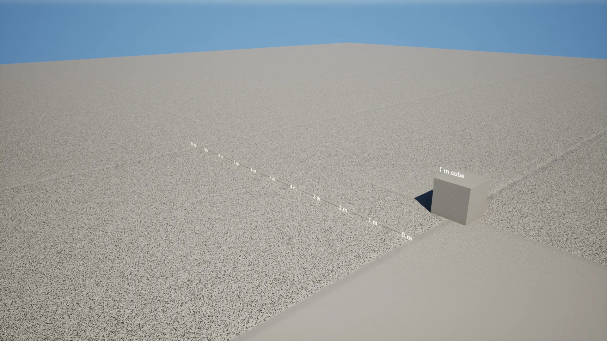
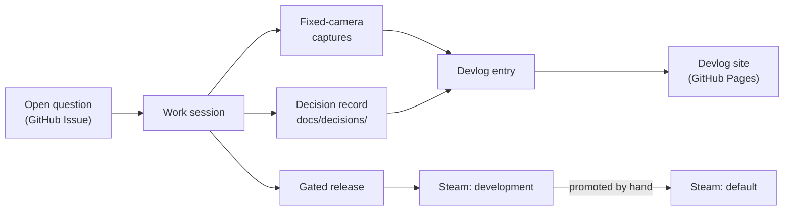

<div align="center">

# Combat Simulator

**A moddable physics sandbox for Steam, built in public with Unreal Engine 5.8.**

Every design decision, every work session and every Steam build is recorded in this repository as it happens, and published to a devlog that anyone can follow. The game does not exist yet. The workshop it will be built in does.

<br />

[](https://tmhsdigital.github.io/Open-Game-1/)
[](https://github.com/TMHSDigital/Open-Game-1/issues?q=is%3Aissue+is%3Aopen+label%3Adecision)

<br />

[](https://github.com/TMHSDigital/Open-Game-1/actions/workflows/checks.yml)
[](https://github.com/TMHSDigital/Open-Game-1/actions/workflows/pages.yml)
[](Game/)
[](#license)

<br />



<sub>Session 0: the empty capture stage. The same fixed cameras photograph it every session, so the <a href="https://tmhsdigital.github.io/Open-Game-1/gallery.html">gallery</a> becomes a time-lapse of the game taking shape.</sub>

[Status](#status) · [Follow along](#follow-along) · [How it is built](#how-it-is-built) · [Open questions](#open-questions) · [Repository map](#repository-map) · [License](#license)

</div>

## Status

| | |
|---|---|
| **Phase** | Pre-production. The framework is finished; the base character and its movement are built and being tuned. No gameplay yet. |
| **Engine** | Unreal Engine 5.8, C++ project in [`Game/`](Game/): a blank plane with one character, a movement gym and a capture stage |
| **Next decision** | [OD-001: what does a player do in the first 10 minutes?](https://github.com/TMHSDigital/Open-Game-1/issues/1) |
| **Steam** | Build 0.1.1 is live on the private development branch; nothing is on the public default branch yet ([setup checklist](docs/steam/SETUP-CHECKLIST.md), [build history](https://tmhsdigital.github.io/Open-Game-1/builds.html)) |
| **Latest devlog** | [Session 0: framework](docs/devlog/2026-11-22-01-session-0-framework.md) |

## Follow along

| Where | What you get |
|---|---|
| [Devlog site](https://tmhsdigital.github.io/Open-Game-1/) | One entry per work session: the goal, what changed, the decisions it touched, and screenshots |
| [Gallery](https://tmhsdigital.github.io/Open-Game-1/gallery.html) | Each fixed camera with a slider to scrub through its shots over time |
| [Decisions](https://tmhsdigital.github.io/Open-Game-1/decisions.html) | What is settled, why, and what was rejected |
| [Open questions](https://github.com/TMHSDigital/Open-Game-1/issues?q=is%3Aissue+is%3Aopen+label%3Adecision) | GitHub Issues where anyone can comment before a decision is made |
| [Steam builds](https://tmhsdigital.github.io/Open-Game-1/builds.html) | Every upload, and when it went live on each Steam branch |

Watch the repository (Watch, Custom, Releases and Issues) to get notified when builds ship and new questions open.

## How it is built

Every piece of work follows the same loop, and every step leaves a public trace.



- **Decisions are written down before they are acted on.** Open questions live in [`docs/OPEN-DECISIONS.md`](docs/OPEN-DECISIONS.md) and as Issues. Settled ones become numbered records in [`docs/decisions/`](docs/decisions/), listing only the options that were actually weighed.
- **Sessions leave a record.** A session ends with a devlog entry, fixed-camera stills of the current build and, when recorded, a short clip. Anything captured from the desktop is checked for secrets before it can be published.
- **Releases are gated.** One local command checks the tree, runs the tests, scans for secrets, packages a Shipping build, uploads it to Steam's password-protected `development` branch and records it. Promotion to the public `default` branch is always done by hand in Steamworks.
- **Nothing private gets in.** A secrets scanner runs before every commit, in CI and before every release. Steam App and Depot IDs, keys, account names, unpublished release notes and Steamworks partner-page screenshots never enter the repository.
- **Third-party assets are license-checked.** Each one is recorded in a ledger with its source and license; anything non-commercial, no-derivatives, share-alike or GPL-family is refused, and [`CREDITS.md`](CREDITS.md) is generated from the ledger.

The details, step by step: [`docs/WORKFLOWS.md`](docs/WORKFLOWS.md). The tools behind them: [`docs/TOOLS.md`](docs/TOOLS.md).

### Tooling

| Tool | Used for |
|---|---|
| [Unreal Engine 5.8](https://www.unrealengine.com/) and Unreal MCP | The game, automation tests, fixed-camera captures |
| [Blender](https://www.blender.org/) with [Blender-Developer-Tools](https://github.com/TMHSDigital/Blender-Developer-Tools) | Models and the Blender to Unreal export pipeline |
| [screencast-mcp](https://github.com/TMHSDigital/screencast-mcp) | Session recordings, contact sheets, redaction |
| [steam-mcp](https://github.com/TMHSDigital/steam-mcp) and steamcmd | Steam branch and build checks, SteamPipe uploads |
| [Free-Game-Dev-Assets](https://github.com/TMHSDigital/Free-Game-Dev-Assets) | Finding free, commercially usable assets |
| `og` (in [`tools/og/`](tools/og/)) | Secrets scan, asset ledger, decisions, sessions, the devlog site |
| [Claude Code](https://claude.com/claude-code) | Pair-building, with project skills in [`.claude/skills/`](.claude/skills/) |

## Open questions

The game's design is being worked out in the open. The current questions, each with an Issue for comments:

| | Question |
|---|---|
| [OD-001](https://github.com/TMHSDigital/Open-Game-1/issues/1) | Core loop: what does a player do in the first 10 minutes? |
| [OD-003](https://github.com/TMHSDigital/Open-Game-1/issues/3) | Modding technology: content plugins, a scripting layer, or both |
| [OD-005](https://github.com/TMHSDigital/Open-Game-1/issues/5) | Multiplayer: none, local or online |
| [OD-006](https://github.com/TMHSDigital/Open-Game-1/issues/6) | Art direction |

[All open questions](docs/OPEN-DECISIONS.md)

## Repository map

```
Game/             Unreal Engine 5.8 project (C++ module CombatSimulator, dev-only CSCapture module)
docs/decisions/   Numbered decision records
docs/devlog/      Session entries and their images
docs/captures/    Fixed-camera definitions and capture index
docs/steam/       Setup checklist, build history, release workflow
tools/og/         Python tooling: secrets, assets, decisions, sessions, site
tools/ue/         Build, test, package and capture scripts
tools/steam/      Gated Steam release script and its tests
steam/templates/  SteamPipe build configs (no IDs)
site/             Devlog site templates
.claude/skills/   Project skills for Claude Code
```

## Contributing

This is a solo project built in public. Pull requests are not accepted for now ([OD-011](https://github.com/TMHSDigital/Open-Game-1/issues/11)), but comments on the open-question Issues are welcome and read.

## License

Source-available, all rights reserved. The source is public for viewing and learning only: viewing or forking it grants no license to use, copy, modify or distribute it. Third-party assets keep their own licenses (see [`CREDITS.md`](CREDITS.md)). Mod terms will be published separately ([OD-002](https://github.com/TMHSDigital/Open-Game-1/issues/2)). Full text in [LICENSE](LICENSE).
