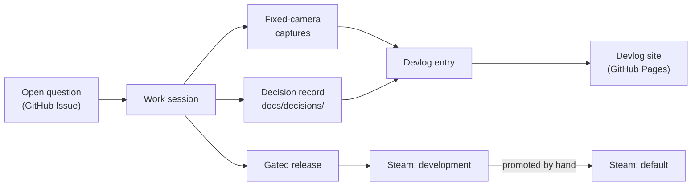

<div align="center">

# Combat Simulator

**A moddable, physics-driven combat simulator for Steam, built in public with Unreal Engine 5.8.**

Every design decision, every work session and every Steam build is recorded in this repository as it happens, and published to a devlog that anyone can follow. The game is an early prototype: a faceless, physically simulated character that moves, punches, blocks and dodges, against dummies that stand and take hits or fight back, in short simulation runs that are set up, played and measured.

<br />

[](https://tmhsdigital.github.io/Open-Game-1/)
[](https://github.com/TMHSDigital/Open-Game-1/issues?q=is%3Aissue+is%3Aopen+label%3Adecision)

<br />

[](https://github.com/TMHSDigital/Open-Game-1/actions/workflows/checks.yml)
[](https://github.com/TMHSDigital/Open-Game-1/actions/workflows/pages.yml)
[](Game/)
[](#license)

<br />


<sub>The start plane: the player and a target dummy. The same fixed cameras photograph the game every session, so the <a href="https://tmhsdigital.github.io/Open-Game-1/gallery.html">gallery</a> becomes a time-lapse of the game taking shape.</sub>

[Status](#status) · [In the build](#in-the-build) · [Follow along](#follow-along) · [How it is built](#how-it-is-built) · [Open questions](#open-questions) · [Repository map](#repository-map) · [Setting up a clone](#setting-up-a-clone) · [License](#license)

</div>

## Status

| | |
|---|---|
| **Phase** | Early prototype. Movement, a physics body that staggers and falls, simulation runs, a punch, a block and a dodge, and an opponent that fights back. Stand-in animation clips, no art direction yet. |
| **Engine** | Unreal Engine 5.8, C++ project in [`Game/`](Game/): a start plane, a movement gym and a capture stage |
| **Latest block** | [Decision 0019](docs/decisions/0019-next-block-an-opponent-that-fights-back-with-a-block-and-a-d.md): an opponent that fights back, with a block and a dodge |
| **Steam** | Build 0.1.10 is live on the private development branch; the game is not publicly available yet ([setup checklist](docs/steam/SETUP-CHECKLIST.md), [build history](https://tmhsdigital.github.io/Open-Game-1/builds.html)) |
| **Latest devlog** | [Make updating the docs part of every session](docs/devlog/2026-11-26-02-make-updating-the-docs-part-of-every-ses.md) |

## In the build

- **A character with weight.** Walk, jog, a sprint that builds up, crouch and jump, with first and third person on one key. The upper body is simulated: hits stagger it, big ones knock it down, and it gets back up.
- **Simulation runs.** The pause screen's Run tab sets a run up: the map, how many dummies, where they stand, whether they stand still or fight back and how long their wind-up is, ball launchers, a time limit and a knockdown goal. A run ends with its results: hits dealt and taken, punches landed and blocked, their punches, dodges.
- **A punch, a block and a dodge.** The punch goes for the nearest opponent in front of you and steps in when it is out of reach. Near an opponent you face it and back off slower. The block takes most of a hit from in front; the dodge is a quick step with no immunity.
- **An opponent that fights back.** It closes in, draws its fist back slowly (its tell), punches, backs off and circles. It waits while you are down.

| Do | Keyboard and mouse | Gamepad |
|---|---|---|
| Move, look | WASD, mouse | Left stick, right stick |
| Punch | Left mouse | Right trigger |
| Block (hold) | Right mouse | Left trigger |
| Dodge | Q | X / left face button |
| Jump, sprint, walk, crouch | Space, Left Shift, Left Alt, Left Ctrl | A, L3, LB, B |
| First or third person | V | R3 |
| Pause screen (runs, settings, tuning, keys) | Escape or Tab | Start |

The dev keys (overlay, ragdoll, push, throw, reset, map switch) and the tuning tab are listed in [`docs/WORKFLOWS.md`](docs/WORKFLOWS.md#tune-character-movement).

## Follow along

| Where | What you get |
|---|---|
| [Devlog site](https://tmhsdigital.github.io/Open-Game-1/) | One entry per work session: the goal, what changed, the decisions it touched, and screenshots |
| [Feed](https://tmhsdigital.github.io/Open-Game-1/feed.xml) | An Atom feed of the devlog entries, for any feed reader |
| [Gallery](https://tmhsdigital.github.io/Open-Game-1/gallery.html) | Each fixed camera with a slider to scrub through its shots over time |
| [Decisions](https://tmhsdigital.github.io/Open-Game-1/decisions.html) | What is settled, why, and what was rejected |
| [Open questions](https://github.com/TMHSDigital/Open-Game-1/issues?q=is%3Aissue+is%3Aopen+label%3Adecision) | GitHub Issues where anyone can comment before a decision is made |
| [Steam builds](https://tmhsdigital.github.io/Open-Game-1/builds.html) | Every upload, and when it went live on each Steam branch |

Watch the repository (Watch, Custom, Releases and Issues) to get notified when builds ship and new questions open.

## How it is built

Every piece of work follows the same loop, and every step leaves a public trace.



- **Decisions are written down before they are acted on.** Open questions live in [`docs/OPEN-DECISIONS.md`](docs/OPEN-DECISIONS.md) and as Issues. Settled ones become numbered records in [`docs/decisions/`](docs/decisions/), listing only the options that were actually weighed.
- **Sessions leave a record.** A session ends with a devlog entry, fixed-camera stills of the current build and, when recorded, a short clip. It cannot end until the docs are up to date: the README's status names the newest decision, build and devlog entry, and a session that changed code changed the docs too. Anything captured from the desktop is checked for secrets before it can be published.
- **The game is play-tested on a recording.** The game plays itself through scripted scenarios (moving, the combat stance, punches, knockdowns, a fight) with a camera that frames the whole body, and logs what happened. A script records it and cuts a clip, a contact sheet and a summary for each segment, so a change is judged by watching it, not only by tests.
- **Releases are gated.** One local command checks the tree, runs the tests, scans for secrets, packages a Shipping build, uploads it to Steam's password-protected `development` branch and records it. Promotion to the public `default` branch is always done by hand in Steamworks.
- **Nothing private gets in.** A secrets scanner runs before every commit (through the commit hook, see [Setting up a clone](#setting-up-a-clone)), in CI and before every release. Steam App and Depot IDs, keys, account names, unpublished release notes and Steamworks partner-page screenshots never enter the repository.
- **Third-party assets are license-checked.** Each one is recorded in a ledger with its source and license; anything non-commercial, no-derivatives, share-alike or GPL-family is refused, and [`CREDITS.md`](CREDITS.md) is generated from the ledger.

The details, step by step: [`docs/WORKFLOWS.md`](docs/WORKFLOWS.md). The tools behind them: [`docs/TOOLS.md`](docs/TOOLS.md).

### Tooling

| Tool | Used for |
|---|---|
| [Unreal Engine 5.8](https://www.unrealengine.com/) and Unreal MCP | The game, automation tests, fixed-camera captures |
| [Blender](https://www.blender.org/) with [Blender-Developer-Tools](https://github.com/TMHSDigital/Blender-Developer-Tools) | Models and the Blender to Unreal export pipeline |
| [screencast-mcp](https://github.com/TMHSDigital/screencast-mcp) | Session recordings, contact sheets, redaction, frame-by-frame review of play-tests |
| [ffmpeg](https://ffmpeg.org/) | Recording and cutting the scripted play-tests (`tools/ue/playtest.ps1`) |
| [steam-mcp](https://github.com/TMHSDigital/steam-mcp) and steamcmd | Steam branch and build checks, SteamPipe uploads |
| [Free-Game-Dev-Assets](https://github.com/TMHSDigital/Free-Game-Dev-Assets) | Finding free, commercially usable assets |
| `og` (in [`tools/og/`](tools/og/)) | Secrets scan, asset ledger, decisions, sessions, the devlog site |
| [Claude Code](https://claude.com/claude-code) | Pair-building, with project skills in [`.claude/skills/`](.claude/skills/) |

## Open questions

The game's design is being worked out in the open. The current questions, each with an Issue for comments:

| | Question |
|---|---|
| [OD-003](https://github.com/TMHSDigital/Open-Game-1/issues/3) | Modding technology: content plugins, a scripting layer, or both |
| [OD-005](https://github.com/TMHSDigital/Open-Game-1/issues/5) | Multiplayer: none, local or online |
| [OD-006](https://github.com/TMHSDigital/Open-Game-1/issues/6) | Art direction |

[All open questions](docs/OPEN-DECISIONS.md)

## Repository map

```
Game/             Unreal Engine 5.8 project (C++ module CombatSimulator with runs, the opponent, hit feedback and the play-test runner; CSCharacter plugin with the character, its physics body, punch and guard; dev-only CSCapture module)
Art/              Blender sources (the base character is built by script)
docs/decisions/   Numbered decision records
docs/devlog/      Session entries and their images
docs/captures/    Fixed-camera definitions and capture index
docs/steam/       Setup checklist, build history, release workflow
tools/og/         Python tooling: secrets, assets, decisions, sessions, site
tools/ue/         Build, test, package, capture and play-test scripts
tools/steam/      Gated Steam release script and its tests
steam/templates/  SteamPipe build configs (no IDs)
site/             Devlog site templates
.claude/skills/   Project skills for Claude Code
```

## Setting up a clone

The project is developed on Windows. A fresh clone needs these steps once; the second one matters most, because without it commits are not scanned before they are made:

1. Install [Git LFS](https://git-lfs.com/) and run `git lfs install` (models, maps and Unreal assets are LFS files).
2. Enable the commit hook: `git config core.hooksPath tools/hooks`. It runs the secrets scan, the asset license check and the decisions check on every commit, and carries the Git LFS hooks.
3. Install [uv](https://docs.astral.sh/uv/) and PowerShell 7. Check the tooling with `uv run --project tools pytest tools/tests -q` and `pwsh tools/steam/test-release.ps1`.
4. To build the game: Unreal Engine 5.8 (set the `UE_ROOT` environment variable if it is not in the default location, see [`docs/TOOLS.md`](docs/TOOLS.md)) and Blender for the character build.
5. Steam uploads read their IDs from a local `.env` (copy `.env.example`); that file is never committed.

## Contributing

This is a solo project built in public. Pull requests are not accepted for now ([OD-011](https://github.com/TMHSDigital/Open-Game-1/issues/11)), but comments on the open-question Issues are welcome and read.

## License

Source-available, all rights reserved. The source is public for viewing and learning only: viewing or forking it grants no license to use, copy, modify or distribute it. Third-party assets keep their own licenses (see [`CREDITS.md`](CREDITS.md)). Mod terms will be published separately ([OD-002](https://github.com/TMHSDigital/Open-Game-1/issues/2)). Full text in [LICENSE](LICENSE).
