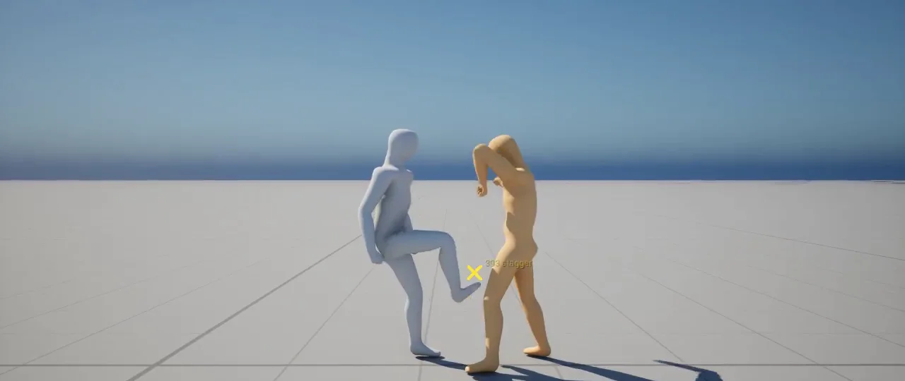
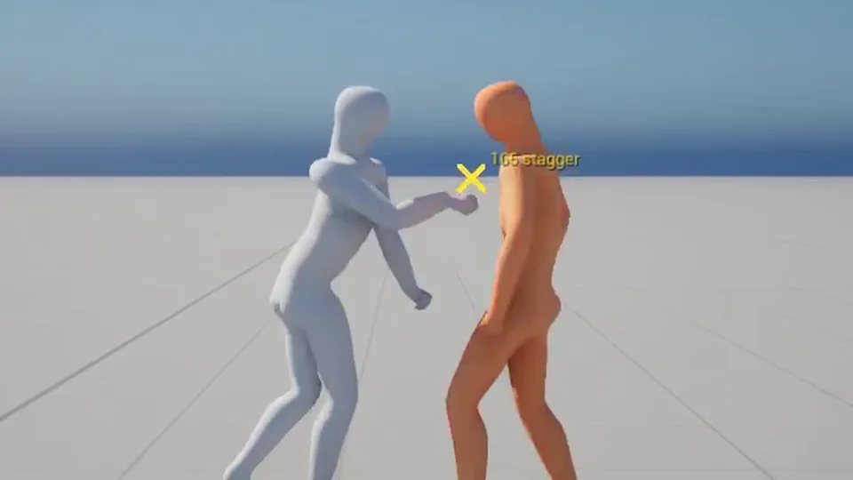
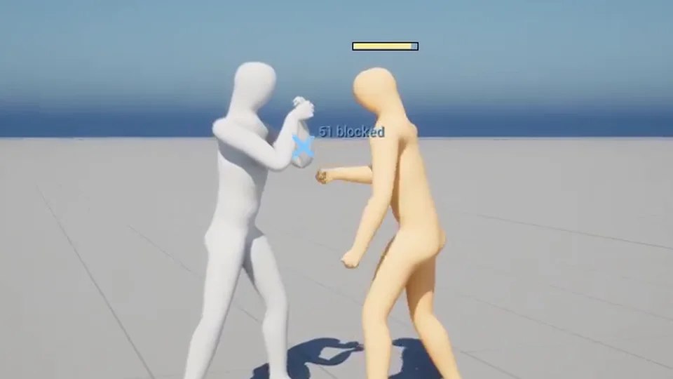
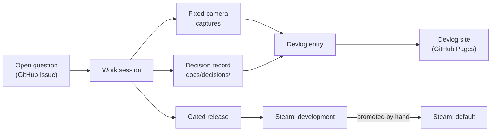

<div align="center">

# Combat Simulator

**A combat sandbox where the fight is physics. Built in public with Unreal Engine 5.8, for Steam.**



<sub>A front kick in the current build, from a recorded play-test: 393 cm/s into the dummy's thigh, a stagger.</sub>

<br /><br />

[](https://tmhsdigital.github.io/Open-Game-1/)
[](https://github.com/TMHSDigital/Open-Game-1/issues?q=is%3Aissue+is%3Aopen+label%3Adecision)

[](https://github.com/TMHSDigital/Open-Game-1/actions/workflows/checks.yml)
[](https://github.com/TMHSDigital/Open-Game-1/actions/workflows/pages.yml)
[](Game/)
[](#license)

[Status](#status) · [In the build](#in-the-build) · [Follow along](#follow-along) · [How it is built](#how-it-is-built) · [Open questions](#open-questions) · [Repository map](#repository-map) · [Setting up a clone](#setting-up-a-clone) · [License](#license)

</div>

A punch here is a fist steered at a body through the physics engine. The hit is the momentum it carries, and it staggers or knocks a body down by the same rules as a thrown ball or a fall. Two faceless figures on a grey grid plane fight it out: one is you, the other a dummy that stands still or fights back.

It is an early prototype, made by one developer, and every design decision, work session and Steam build is recorded in this repository as it happens. There is no art yet, and the animation is stand-in clips with the rest done in code.

<table>
<tr>
<td width="50%"></td>
<td width="50%"></td>
</tr>
<tr>
<td><sub>A straight to the chest. The struck body flashes and the mark gives the size of the hit.</sub></td>
<td><sub>The dummy's punch on a raised guard: 51 cm/s got through. Its stamina bar is over its head.</sub></td>
</tr>
</table>

## Status

| | |
|---|---|
| **Phase** | Early prototype. Movement, a physics body that staggers and falls, simulation runs, five strikes (jab, straight, two hooks, a kick), a block and a dodge, stamina, and an opponent that fights back. Stand-in animation clips, no art direction yet. |
| **Engine** | Unreal Engine 5.8, C++ project in [`Game/`](Game/): a start plane, a movement gym and a capture stage |
| **Latest block** | [Decision 0024](docs/decisions/0024-claude-records-a-promotion-once-steam-shows-it-live-on-defau.md): Claude records a promotion once Steam shows it live on default |
| **Steam** | Build 0.1.12 is live on the private development branch; build 0.1.11 is live on the default branch (promoted 2026-11-27); the game is not publicly available yet ([setup checklist](docs/steam/SETUP-CHECKLIST.md), [build history](https://tmhsdigital.github.io/Open-Game-1/builds.html)) |
| **Latest devlog** | [Realistic art direction and the base character rebuild](docs/devlog/2026-11-27-01-polish-the-base-character-the-model-s-sc.md) |

## In the build

- You move with weight: walk, jog, a sprint that builds up, crouch and jump, in first or third person on one key. The upper body is simulated, so hits stagger it, big ones knock it down, and it gets back up on its own.
- The attack key throws a jab, and pressed again straight after, a straight: a one-two. Pressed while moving sideways near an opponent it throws a hook from that side. The kick key throws a front kick, slow and heavy, with the leg simulated for its length. Every strike goes for the nearest opponent in front of you and steps in when it is out of reach.
- Near an opponent you face it, and backing off is slower than going forward. Holding the block takes most of a hit from in front. The dodge is a quick step with no immunity: a punch misses because you are no longer where it was going.
- Strikes, dodges and hits taken on the guard cost stamina, shown as a bar under the middle of the screen and over a fighting opponent's head. It comes back after a short pause. Out of it, strikes are slower and weaker and the guard drops until some is back.
- A dummy set to fight back closes in, draws back slowly (its tell) and throws a jab, a one-two, a hook or a kick in a fixed order, then backs off and circles. It holds off when its own stamina is low and waits while you are down.
- The pause screen's Run tab sets a run up: the map, how many dummies and where they stand, whether they fight back and how long their wind-up is, stamina on or off and how fast it recovers, ball launchers, a time limit and a knockdown goal. A run ends with its results: hits dealt and taken, strikes thrown and landed, by move, strikes taken on a guard, their strikes, dodges, and how often you ran out of stamina. Finished runs are kept on this machine (the last 200, in `Saved/Runs/History.jsonl`), and the Run tab shows the best run with the setup being edited and the most recent ones.

| Do | Keyboard and mouse | Gamepad |
|---|---|---|
| Move, look | WASD, mouse | Left stick, right stick |
| Jab, then straight (a one-two) | Left mouse | Right trigger |
| Hook | Left mouse while moving left or right near an opponent | Right trigger with the left stick sideways |
| Kick | F | RB / right shoulder |
| Block (hold) | Right mouse | Left trigger |
| Dodge | Q | X / left face button |
| Jump, sprint, walk, crouch | Space, Left Shift, Left Alt, Left Ctrl | A, L3, LB, B |
| First or third person | V | R3 |
| Pause screen (runs, settings, tuning, keys) | Escape or Tab | Start |

These are the default keys. The pause screen's Keys tab changes them, for the keyboard and mouse and for the gamepad: select a key, then press the new one. A key that is already in use is refused, and the change is kept for the next start. Look and the pause keys are fixed. The dev keys (overlay, ragdoll, push, throw, reset, map switch) and the tuning tab are listed in [`docs/WORKFLOWS.md`](docs/WORKFLOWS.md#tune-character-movement).

## Follow along

| Where | What you get |
|---|---|
| [Devlog site](https://tmhsdigital.github.io/Open-Game-1/) | One entry per work session: the goal, what changed, the decisions it touched, and screenshots |
| [Feed](https://tmhsdigital.github.io/Open-Game-1/feed.xml) | An Atom feed of the devlog entries, for any feed reader |
| [Gallery](https://tmhsdigital.github.io/Open-Game-1/gallery.html) | Each fixed camera with a slider to scrub through its shots over time |
| [Decisions](https://tmhsdigital.github.io/Open-Game-1/decisions.html) | What is settled, why, and what was rejected |
| [Open questions](https://github.com/TMHSDigital/Open-Game-1/issues?q=is%3Aissue+is%3Aopen+label%3Adecision) | GitHub Issues where anyone can comment before a decision is made |
| [Steam builds](https://tmhsdigital.github.io/Open-Game-1/builds.html) | Every upload, and when it went live on each Steam branch |

Watch the repository (Watch, Custom, Releases and Issues) to get notified when builds ship and new questions open.

## How it is built

Every piece of work follows the same loop, and every step leaves a public trace.



- Decisions are written down before they are acted on. Open questions live in [`docs/OPEN-DECISIONS.md`](docs/OPEN-DECISIONS.md) and as Issues. Settled ones become numbered records in [`docs/decisions/`](docs/decisions/), listing only the options that were actually weighed.
- A work session ends with a devlog entry, fixed-camera stills of the current build and, when recorded, a short clip. It cannot end until the docs are up to date: the README's status names the newest decision, build and devlog entry, and a session that changed code changed the docs too. Anything captured from the desktop is checked for secrets before it can be published.
- Changes to how the game plays are checked on a recording. The game plays itself through scripted scenarios (moving, the combat stance, punches, every strike, stamina, knockdowns, a fight) with a camera that frames the whole body, and logs what happened. A script records it and cuts a clip, a contact sheet and a summary for each segment, so a change is judged by watching it, not only by tests.
- Releases are gated: one local command checks the tree, runs the tests, scans for secrets, packages a Shipping build, uploads it to Steam's password-protected `development` branch and records it. Promotion to the public `default` branch is always done by hand in Steamworks.
- Nothing private gets in. A secrets scanner runs before every commit (through the commit hook, see [Setting up a clone](#setting-up-a-clone)), in CI and before every release. Steam App and Depot IDs, keys, account names, unpublished release notes and Steamworks partner-page screenshots never enter the repository.
- Third-party assets are license-checked. Each one is recorded in a ledger with its source and license; anything non-commercial, no-derivatives, share-alike or GPL-family is refused, and [`CREDITS.md`](CREDITS.md) is generated from the ledger.

The details, step by step: [`docs/WORKFLOWS.md`](docs/WORKFLOWS.md). The tools behind them: [`docs/TOOLS.md`](docs/TOOLS.md).

### Tooling

| Tool | Used for |
|---|---|
| [Unreal Engine 5.8](https://www.unrealengine.com/) and Unreal MCP | The game, automation tests, fixed-camera captures |
| [Blender](https://www.blender.org/) with [Blender-Developer-Tools](https://github.com/TMHSDigital/Blender-Developer-Tools) | Models and the Blender to Unreal export pipeline |
| [screencast-mcp](https://github.com/TMHSDigital/screencast-mcp) | Session recordings, contact sheets, redaction, frame-by-frame review of play-tests |
| [ffmpeg](https://ffmpeg.org/) | Recording and cutting the scripted play-tests (`tools/ue/playtest.ps1`) |
| [steam-mcp](https://github.com/TMHSDigital/steam-mcp) and steamcmd | Steam branch and build checks, SteamPipe uploads |
| [Free-Game-Dev-Assets](https://github.com/TMHSDigital/Free-Game-Dev-Assets) | Finding free, commercially usable assets |
| `og` (in [`tools/og/`](tools/og/)) | Secrets scan, asset ledger, decisions, sessions, the devlog site |
| [Claude Code](https://claude.com/claude-code) | Pair-building, with project skills in [`.claude/skills/`](.claude/skills/) |

## Open questions

The game's design is being worked out in the open. The current questions, each with an Issue for comments:

| | Question |
|---|---|
| [OD-003](https://github.com/TMHSDigital/Open-Game-1/issues/3) | Modding technology: content plugins, a scripting layer, or both |
| [OD-005](https://github.com/TMHSDigital/Open-Game-1/issues/5) | Multiplayer: none, local or online |
| [OD-006](https://github.com/TMHSDigital/Open-Game-1/issues/6) | Art direction |

[All open questions](docs/OPEN-DECISIONS.md)

## Repository map

```
Game/             Unreal Engine 5.8 project (C++ module CombatSimulator with runs, the opponent, hit feedback and the play-test runner; CSCharacter plugin with the character, its physics body, punch and guard; dev-only CSCapture module)
Art/              Blender sources (the base character is built by script)
docs/decisions/   Numbered decision records
docs/devlog/      Session entries and their images
docs/captures/    Fixed-camera definitions and capture index
docs/steam/       Setup checklist, build history, release workflow
tools/og/         Python tooling: secrets, assets, decisions, sessions, site
tools/ue/         Build, test, package, capture and play-test scripts
tools/steam/      Gated Steam release script and its tests
steam/templates/  SteamPipe build configs (no IDs)
site/             Devlog site templates
.claude/skills/   Project skills for Claude Code
```

## Setting up a clone

The project is developed on Windows. A fresh clone needs these steps once; the second one matters most, because without it commits are not scanned before they are made:

1. Install [Git LFS](https://git-lfs.com/) and run `git lfs install` (models, maps and Unreal assets are LFS files).
2. Enable the commit hook: `git config core.hooksPath tools/hooks`. It runs the secrets scan, the asset license check and the decisions check on every commit, and carries the Git LFS hooks.
3. Install [uv](https://docs.astral.sh/uv/) and PowerShell 7. Check the tooling with `uv run --project tools pytest tools/tests -q` and `pwsh tools/steam/test-release.ps1`.
4. To build the game: Unreal Engine 5.8 (set the `UE_ROOT` environment variable if it is not in the default location, see [`docs/TOOLS.md`](docs/TOOLS.md)) and Blender for the character build.
5. Steam uploads read their IDs from a local `.env` (copy `.env.example`); that file is never committed.

## Contributing

This is a solo project built in public. Pull requests are not accepted for now ([OD-011](https://github.com/TMHSDigital/Open-Game-1/issues/11)), but comments on the open-question Issues are welcome and read.

## License

Source-available, all rights reserved. The source is public for viewing and learning only: viewing or forking it grants no license to use, copy, modify or distribute it. Third-party assets keep their own licenses (see [`CREDITS.md`](CREDITS.md)). Mod terms will be published separately ([OD-002](https://github.com/TMHSDigital/Open-Game-1/issues/2)). Full text in [LICENSE](LICENSE).
