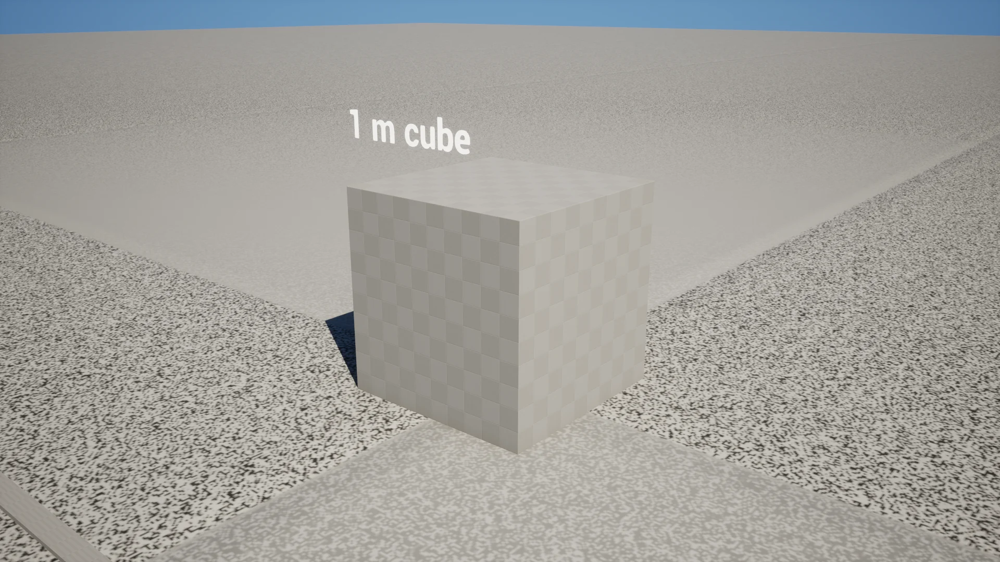
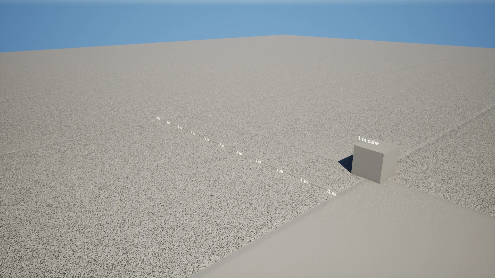

# 2026-11-22-01: Session 0: framework

## Narrative

Session 0 built the framework the game will grow in, and no gameplay yet. The repo now has a source-available license, a secrets scanner and pre-commit hook for a public repo, a ledger that refuses unsuitable third-party licenses, a decision record tied to GitHub Issues, an Unreal 5.8 C++ project with build, test and package scripts, fixed-camera captures (the two images below), this session and milestone routine, a gated Steam release script that the owner runs by hand, and a public site built from the devlog and decisions. The tool and workflow docs and the map of what is reused from the owner's Game-Systems library were added last. Twelve questions are still open as decisions. The next one to settle is OD-001, the core loop: what a player actually does in the first ten minutes, because the modding surface, the art and the networking all hang off it.

## Changes

- 3c17a21 Initial commit
- f2d8d3d chore: repo foundation, license, secrets scanner, LFS
- 430f26d chore: force LF for git hooks
- 0e8fa23 fix: secrets scanner scans index, UTF-16, fails closed on images
- f45ea8d fix: staged scan covers renames, LFS pointers and OCR sidecars
- 5efcd32 fix: staged LFS content verified against pointer and scanned fail-closed
- c1a1309 feat: third-party asset ledger, license check, credits
- 5d1d652 feat: decision record, seed ADRs 0001-0009, open decisions OD-001..012
- 642ff58 fix: decision record uses owner-sourced alternatives, no silent row loss, crash-safe sync
- d975603 feat: UE 5.8 project skeleton, capture stage map, build/test/package scripts
- 9dd55b1 chore: track git-lfs hook shims in tools/hooks
- e2dafb2 feat: fixed-camera capture (CSCapture), cameras.json, webp conversion
- 4ec09cb feat: session start/end routine, devlog, milestones
- d7996f2 fix: session end stages and scans before publishing; skip ended trailers; milestone tags last; clip failures warn
- 2743157 feat: gated Steam release pipeline, BUILDS ledger, Steam branch tracking
- 08715e3 feat: CI checks and public devlog site
- 79b712c docs: tools, workflows, systems map; blender-to-unreal-export skill

## Decisions touched

- OD-001

## Captures

## Clip

_No clip._
