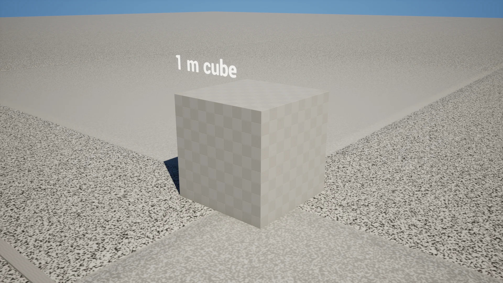
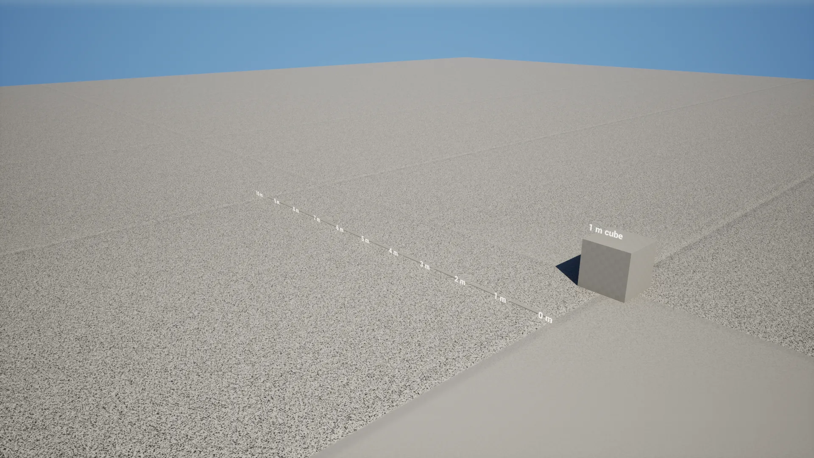

# 2026-11-22-02: Session 1: first build on Steam, faster builds, start OD-001

## Narrative

Combat Simulator is on Steam. Build 0.1.1 (the empty capture stage, no gameplay yet) went through the full pipeline: every safety gate, a Shipping package, a SteamPipe upload, the build history and a GitHub prerelease. It is live on the password-protected development branch and, since the app is unreleased and has no store page, on the default branch for the owner only. It installs from the Steam library and launches to the stage.

Getting there turned up two things worth fixing. A Steam App ID left in the user environment by another project would have redirected the upload, so the repository's own settings now always win and the script warns when they disagree. And the first package took about an hour because every asset was re-cooked; with incremental cooking on, a package that changes nothing now takes under eight minutes. The owner decided to upload with their own Steam account rather than a separate build account (decision 0010).

Next is the first real design decision, OD-001: what a player does in the first ten minutes.

## Changes

- b921664 fix: release gate 7 scans every tracked file; scan published release text; strict -Branch
- 25cbb7f fix: session end requires OCR text for desktop media; commit only its outputs
- 58a2a82 fix: review cleanups: BSD SPDX ids, MCP auto-start off, Pages scope, hook modes, docs
- 7ab8d2a fix: CI secrets scan keeps lfs: false via --lfs-pointers-ok; ADR 0004 names BSD ids
- 5adfd35 docs: new README; no separate Steam build account (ADR 0010)
- f11336c docs: Steam setup steps 1 and 3 done (OS, launch option, publish)
- d91daf9 fix: repo .env wins over inherited Steam env vars in release.ps1
- 52c68c7 docs: Steam setup step 6 done (.env)
- f303eb6 docs: Steam setup step 5 done (steamcmd login)
- b74e7ac fix: site skips unsafe devlog ids and non-http clip links; exact index dedupe
- 959dba5 chore: release 0.1.1
- db6d3d9 docs: record Steam build 0.1.1 (BuildID 26854724)
- ca2ddc6 docs: development branch created; 0.1.1 live on development; Steam setup complete
- 0528be1 feat: Claude may record a confirmed promotion (promoted -OwnerConfirmed)
- f895a0c Revert "feat: Claude may record a confirmed promotion (promoted -OwnerConfirmed)"
- 7e528b4 perf: incremental cooking for packaging

## Decisions touched

- ADR-0004
- ADR-0010

## Captures

## Clip

_No clip._
