# 2026-11-24-01: Session 4: a dummy and props that hit the character, pause and settings, tuning sliders in the Steam build (#16, #17, #18)

## Narrative

The owner played build 0.1.3 and found the character clunky and barebones, both in how it responds and in how it looks. The next goal was chosen from that (decision 0015): a way to pause and quit, sliders to change the movement in the Steam build itself, then a dummy and things that can hit the character. This session built the first two. The dummy and hits (#16) are the next session.

Escape, Tab or gamepad Start now pauses the game and shows one screen with Resume, Quit to desktop and three tabs. Settings has mouse sensitivity, stick sensitivity and invert Y, saved per machine. Keys lists every key, read from the same asset the game binds from, so it cannot drift. Tuning, which only exists while dev tools are on, has a slider and a number box for every movement value. A change applies at once, is saved to a file on that machine and survives a restart; the overlay and the reload line say whether the build runs on its packaged values or on packaged values plus changes. A button copies the changed values out, and a new script bakes them into the tuning asset for the next build.

The ranges for those sliders had to move. The editor reads them from property metadata, which does not exist in a Shipping build, so every value now has a row in one table that the sliders, the validity check and the saved file all read. A test fails when a new value has no row.

Changing a gait speed used to make the feet slide until an editor script was rerun, which a packaged build cannot do. The walk, jog, sprint and crouch clips now get their blend position and play rate while the game runs, from the speed actually moved and each clip's stride, so the feet stay matched to the ground at any slider value. This is the first half of #37. It does not make the stand-in clips look better: the walk clip covers about 104 cm/s at normal speed and still plays at 1.7 times that for a 180 cm/s walk. Own animations are the block after the dummy.

A fresh review of the whole change found six problems, all fixed: a held closing key could reopen the pause screen, a click beside the controls gave focus back to the game, the number box read a lone minus sign as zero, text in the settings file gave the slowest look speed instead of the default, changes that could not be saved were dropped by a respawn, and a locked tuning file was treated as no file. One of those fixes was wrong the first time: closing on key release did not work with the cursor in a number box, which showed up when the packaged Shipping build was driven by scripted key presses and had to be reworked.

Checked in the running game: the three tabs, typing a value and clicking a slider, changes surviving a restart, movement after Resume, and Quit. Not checked: use with a gamepad alone, which the owner should try. Still open on the screen are five small points from the review, among them that the settings sliders write the file on every drag step.

Next: upload this as build 0.1.4 to the development branch, then plan the dummy, the ball, the launcher and contact hits.

## Changes

- 5f01306 docs: decision 0015, next goal after the base character (OD-015)
- 16027b7 feat: range table for movement tuning and an overrides file read in the packaged build (#18)
- fae8834 feat: locomotion play rate follows ground speed at run time (#37)
- 69788cf feat: pause screen with settings, key list and tuning sliders (#17, #18)
- c8af7e5 feat: bake copied tuning values into the asset; docs for the pause screen and tuning in the build (#17, #18)
- 4ad0c99 fix: the feel overlay is hidden while the game is paused (#17)
- 2885ea5 fix: pause screen and saved-file edge cases found in review (#17, #18)
- e673219 fix: Escape closes the pause screen from a number box; a held closing key cannot reopen it (#17)

## Decisions touched

- ADR-0015
- OD-015

## Captures

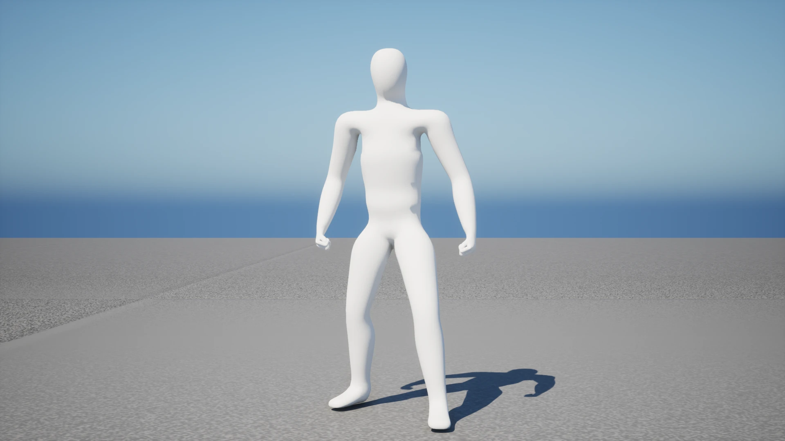

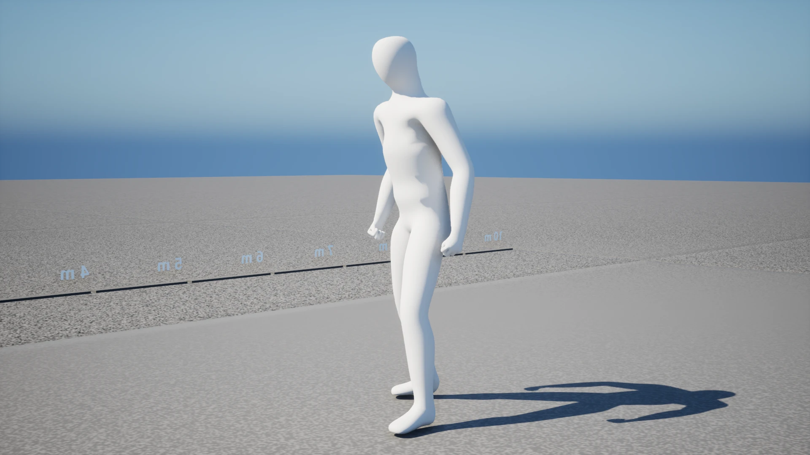
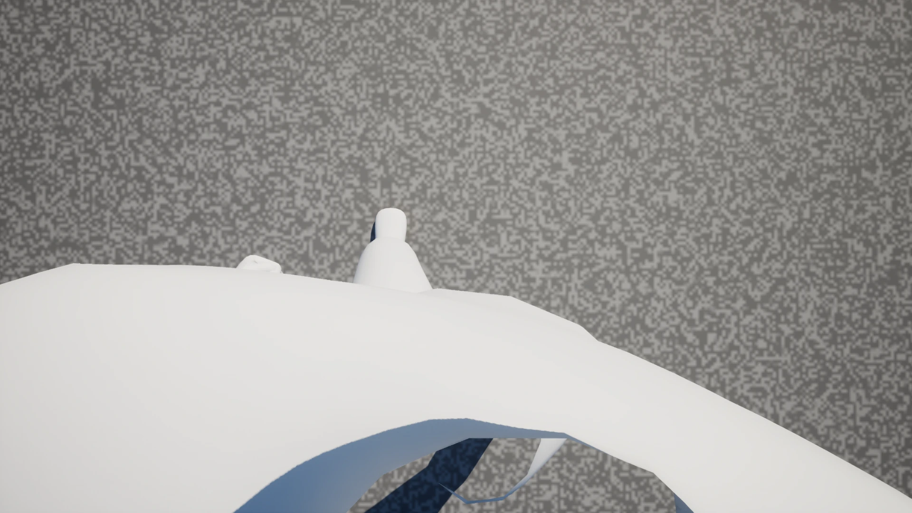

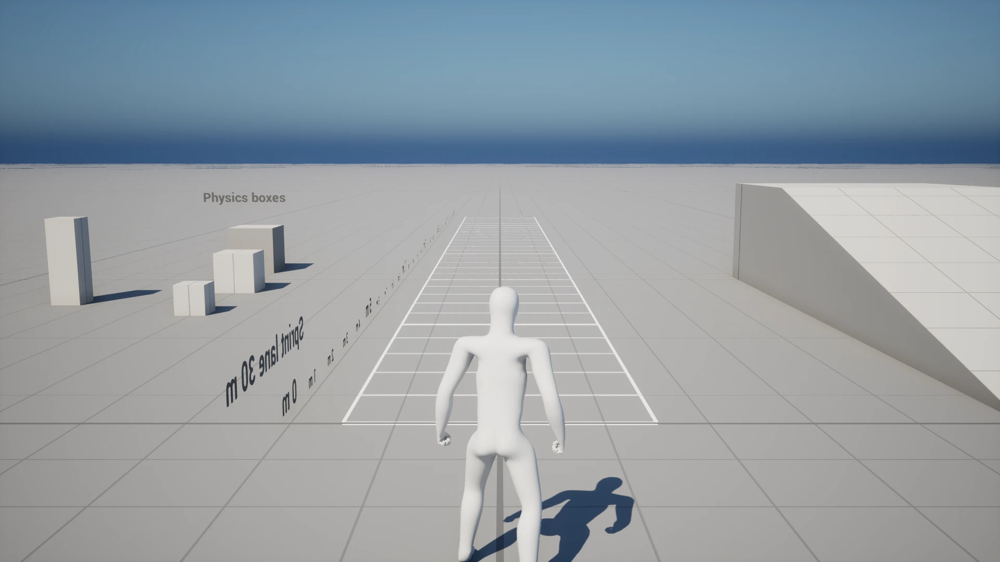

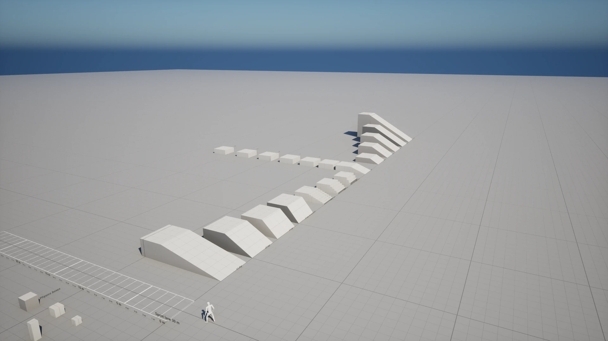

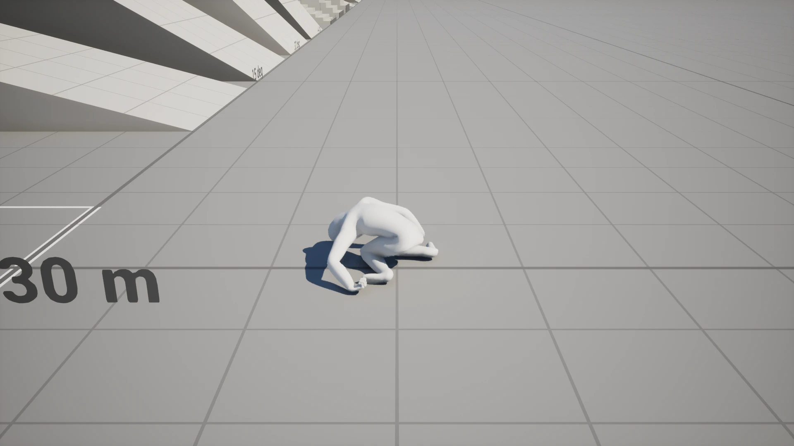
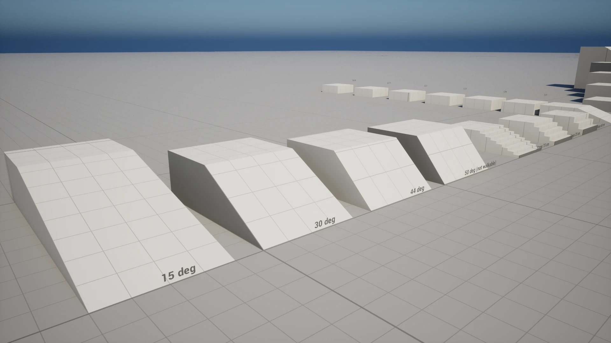

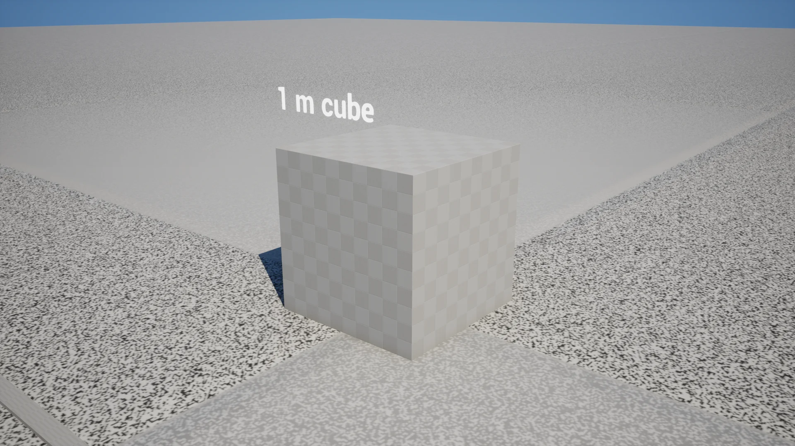
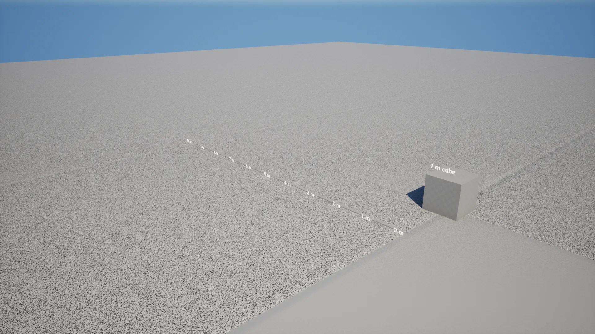
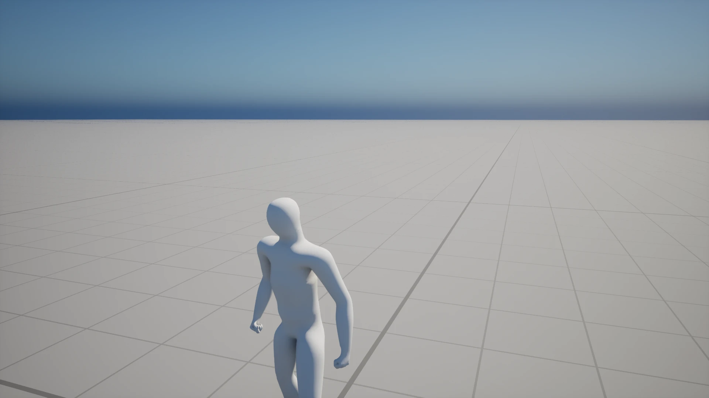
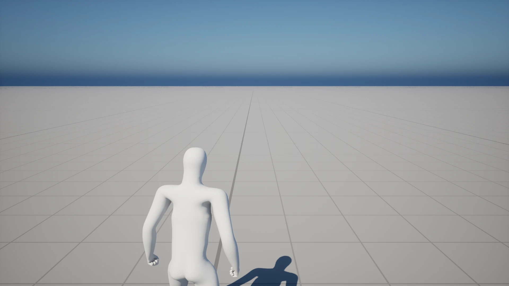
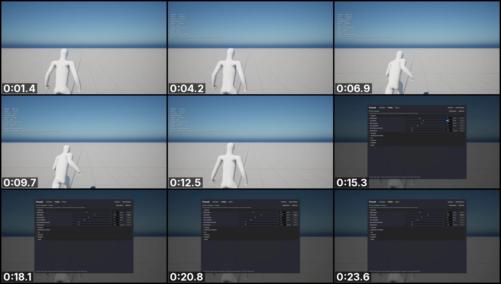

## Clip

[Session clip](https://github.com/TMHSDigital/Open-Game-1/releases/download/media-2026-11/2026-11-24-01.mp4)
