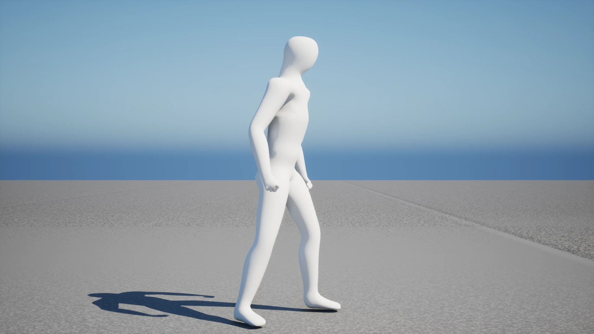
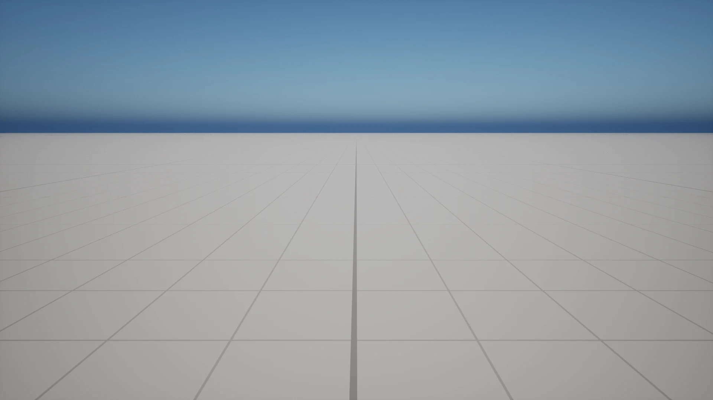
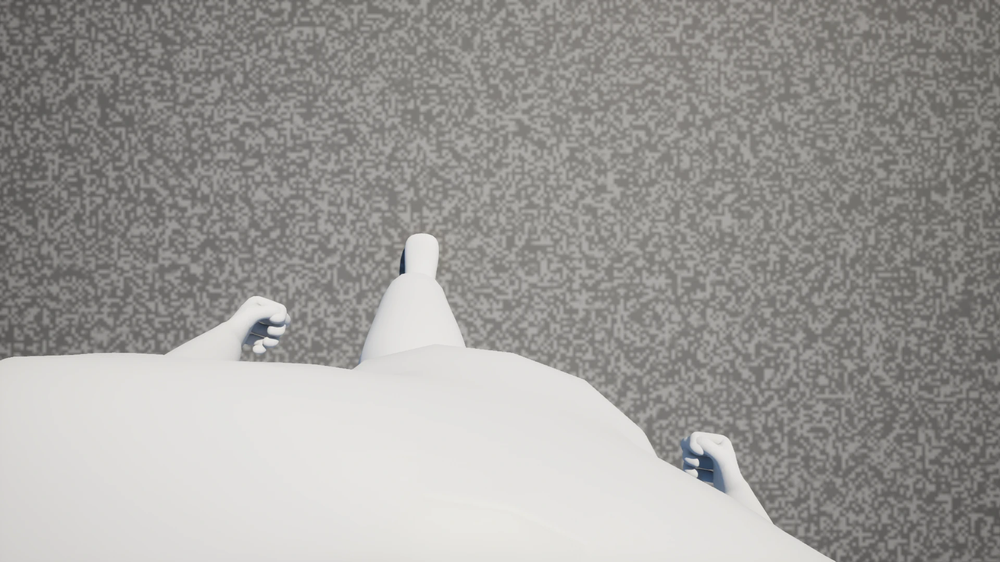
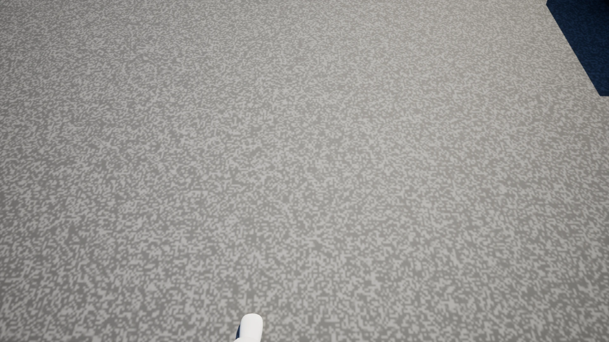
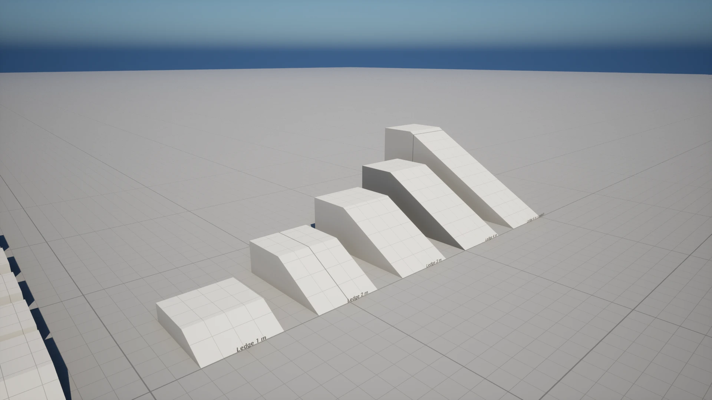
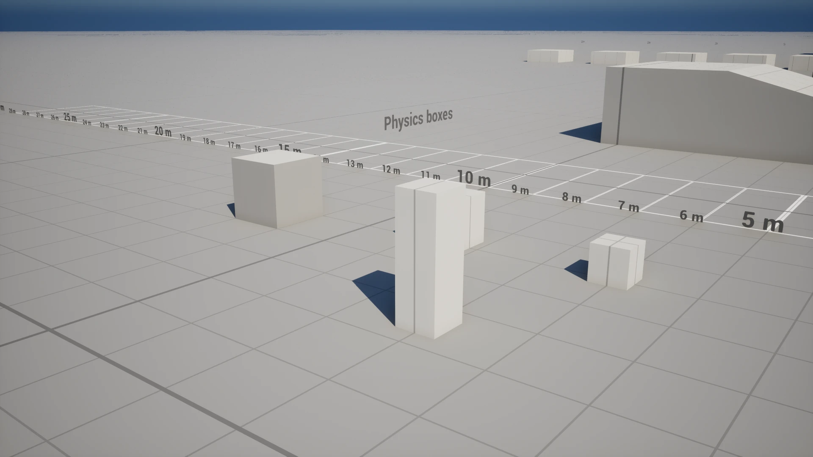
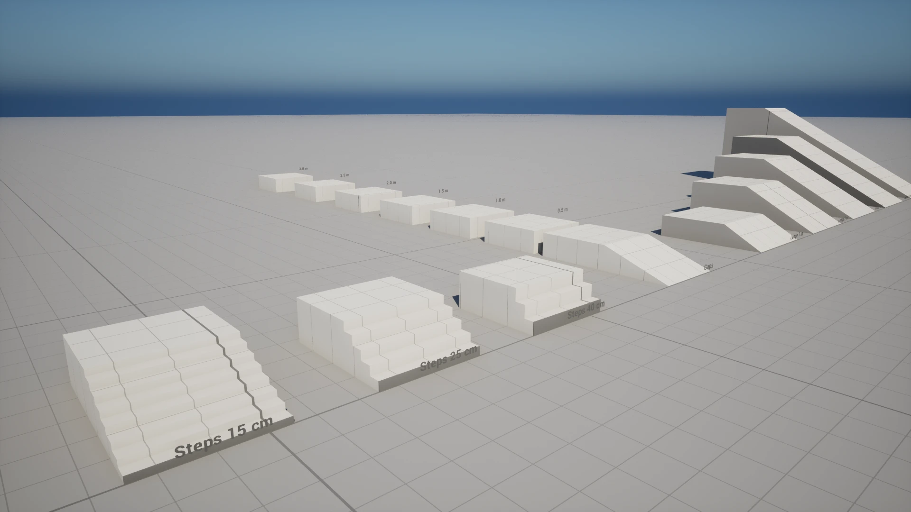
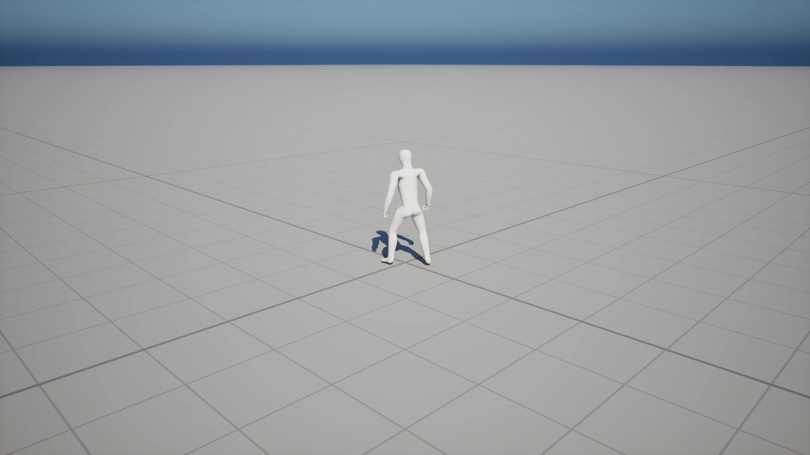

# 2026-11-24-01: Session 4: a dummy and props that hit the character, pause and settings, tuning sliders in the Steam build (#16, #17, #18)

## Narrative

<!-- narrative -->

## Changes

- 5f01306 docs: decision 0015, next goal after the base character (OD-015)
- 16027b7 feat: range table for movement tuning and an overrides file read in the packaged build (#18)
- fae8834 feat: locomotion play rate follows ground speed at run time (#37)
- 69788cf feat: pause screen with settings, key list and tuning sliders (#17, #18)
- c8af7e5 feat: bake copied tuning values into the asset; docs for the pause screen and tuning in the build (#17, #18)
- 4ad0c99 fix: the feel overlay is hidden while the game is paused (#17)
- 2885ea5 fix: pause screen and saved-file edge cases found in review (#17, #18)
- e673219 fix: Escape closes the pause screen from a number box; a held closing key cannot reopen it (#17)

## Decisions touched

- ADR-0015
- OD-015

## Captures

## Clip

[Session clip](https://github.com/TMHSDigital/Open-Game-1/releases/download/media-2026-11/2026-11-24-01.mp4)
