# 2026-11-24-02: Session 5: a dummy, a thrown ball, a launcher and contact hits on the character (#16, #56)

## Narrative

<!-- narrative -->

## Changes

- 70452f2 feat: contact hits, a thrown ball, a launcher and a target dummy (#16, #56)
- 28d2891 feat: the dummy is tinted; docs for contact hits, the ball, the launcher and reset (#16)
- d10b21f fix: contact hits use the closing speed; character contacts are scaled; the ball's mesh is always cooked (#16)

## Decisions touched

_None._

## Captures

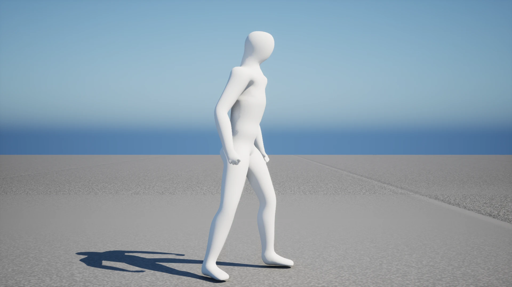

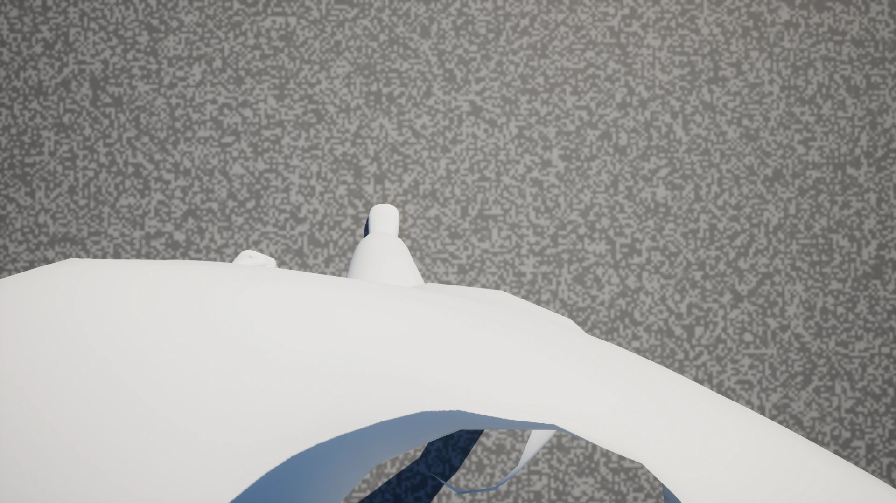
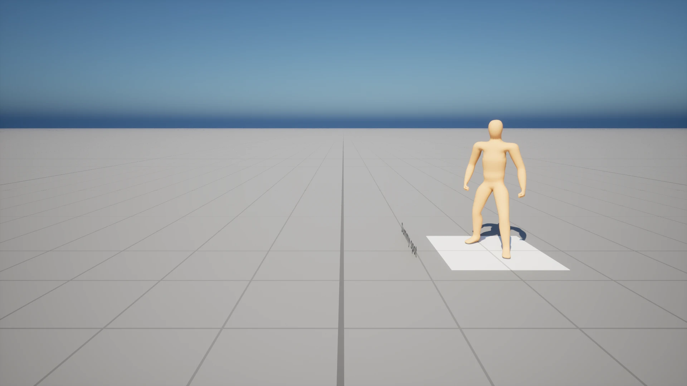

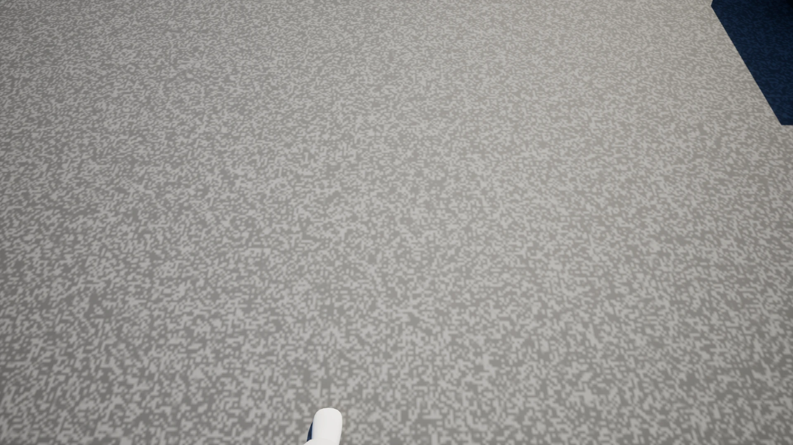
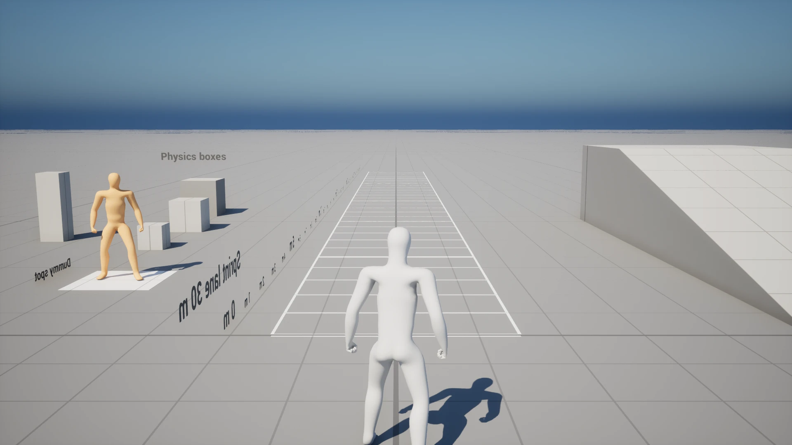

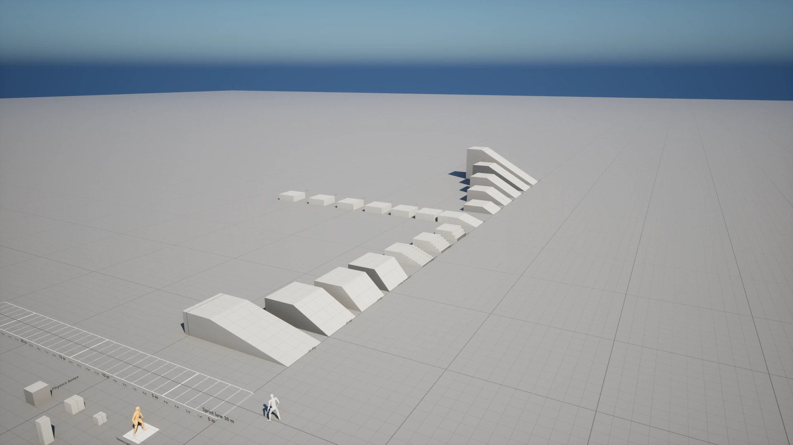
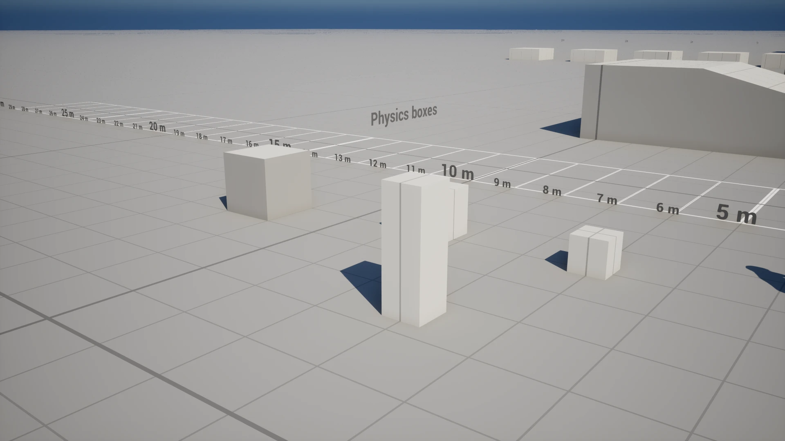
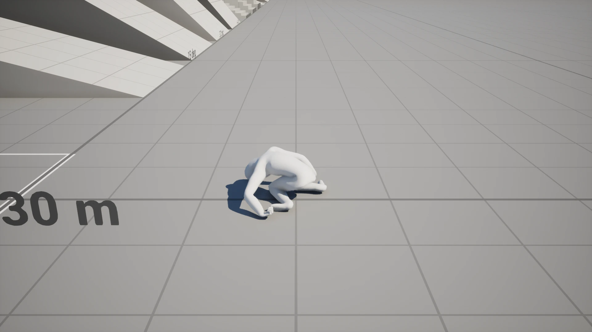
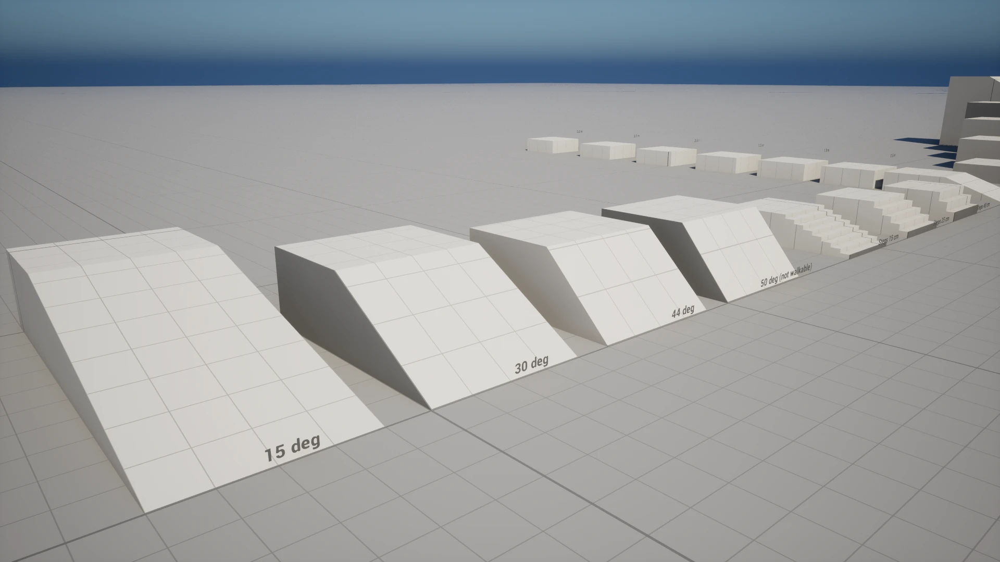
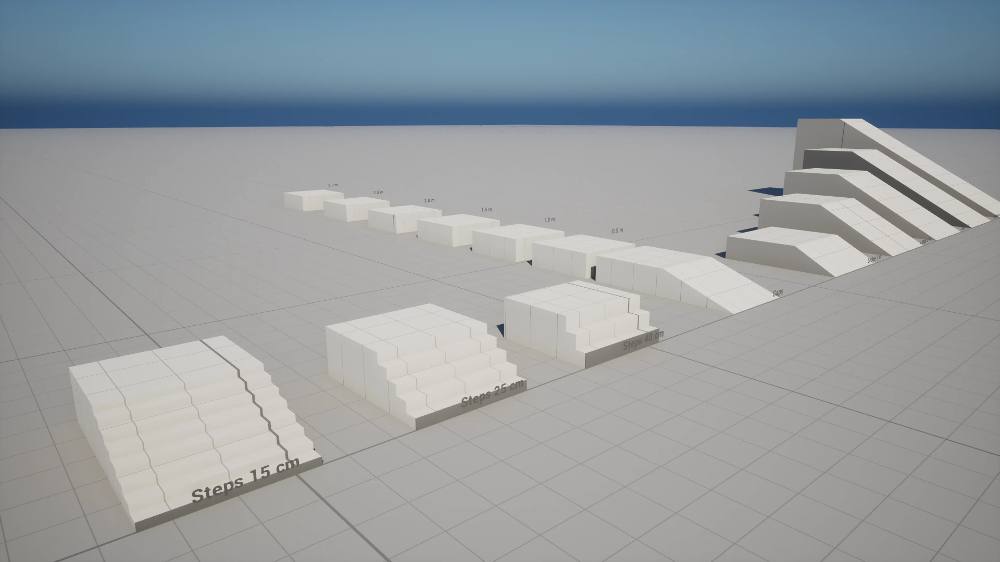

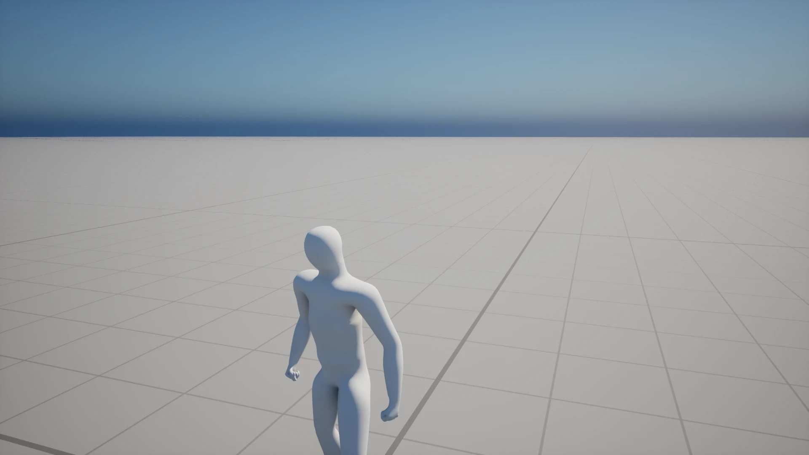

## Clip

_No clip._
