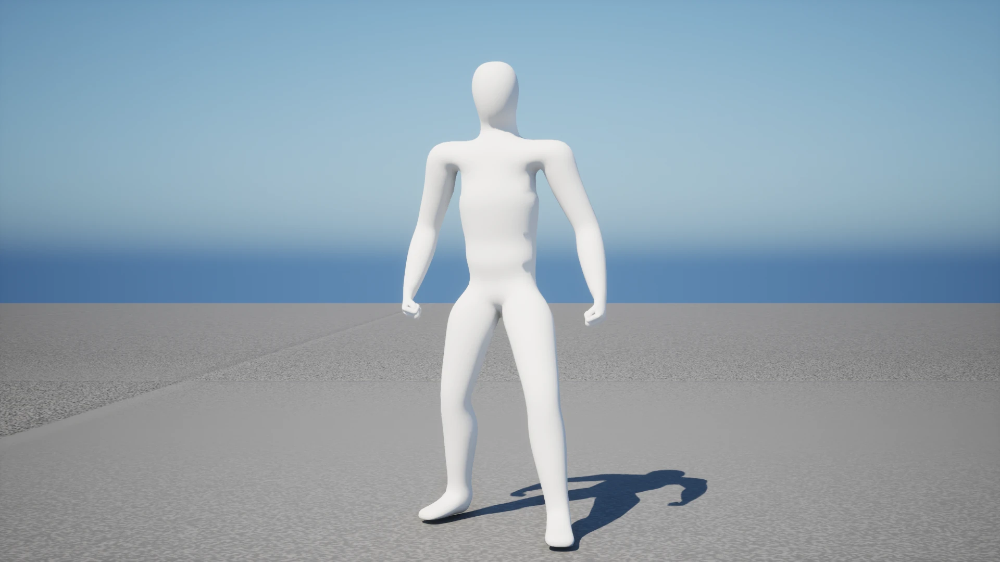
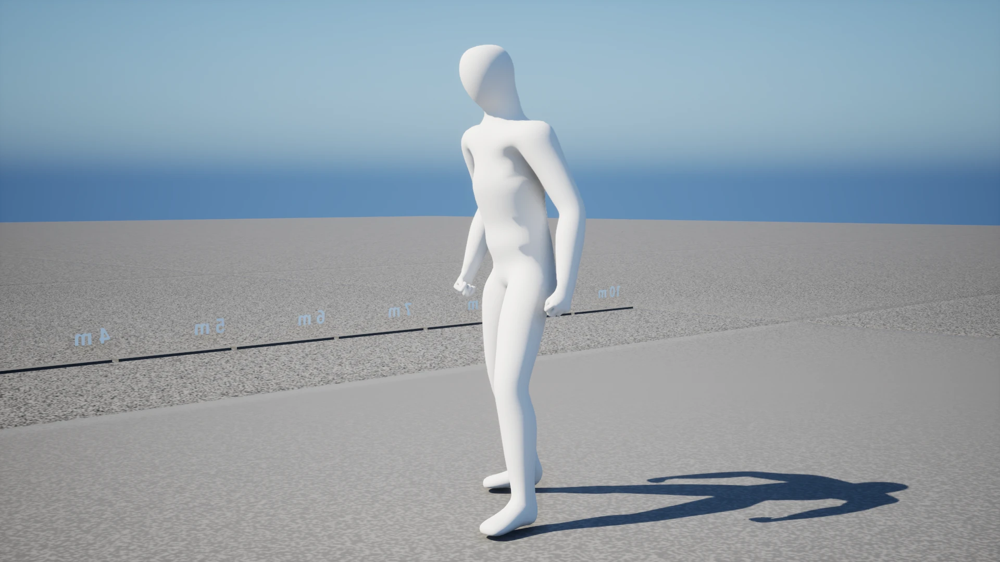
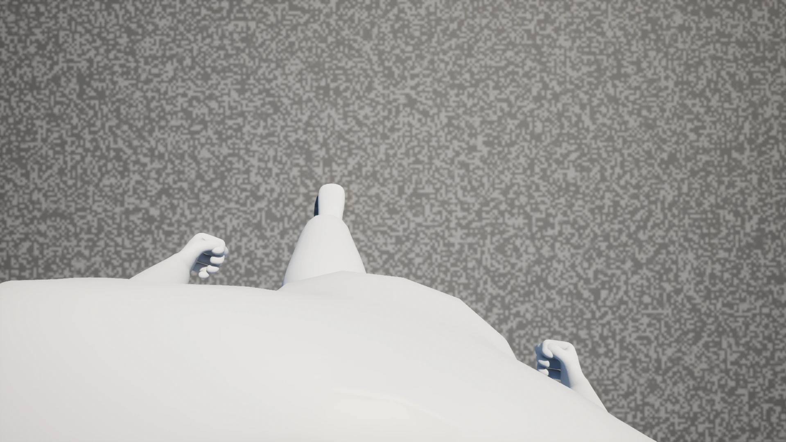
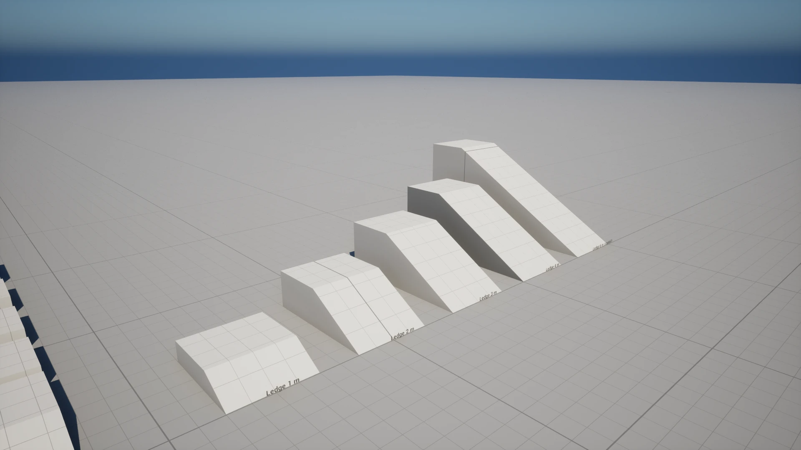
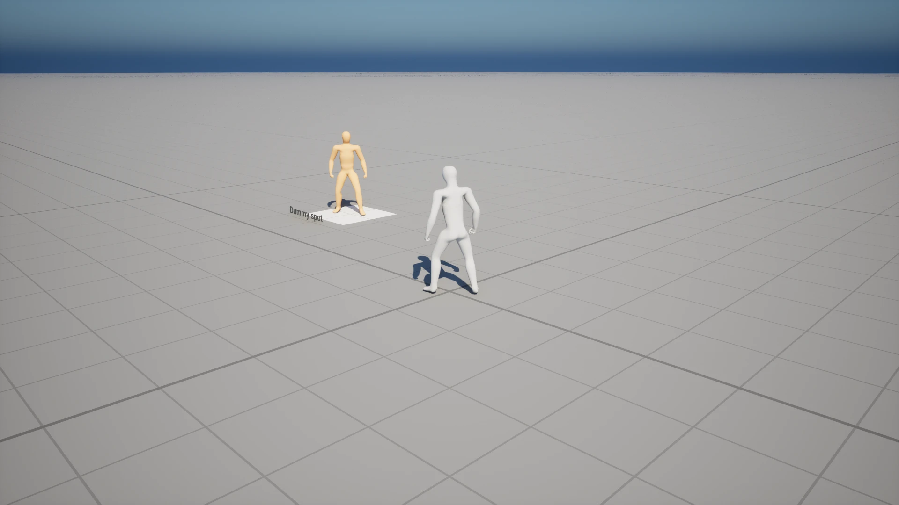
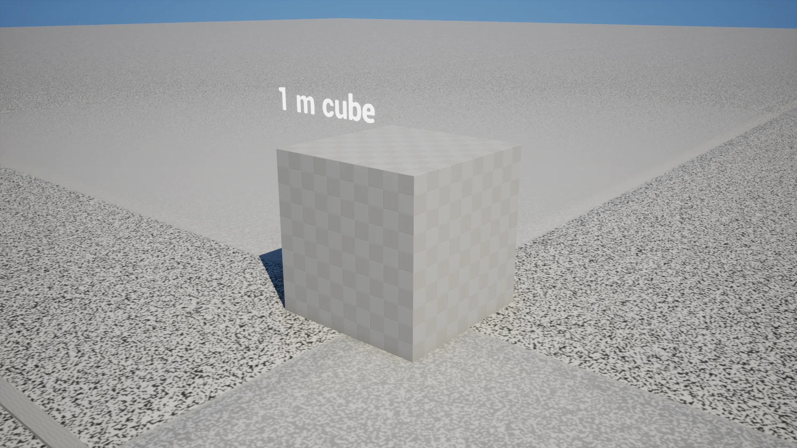
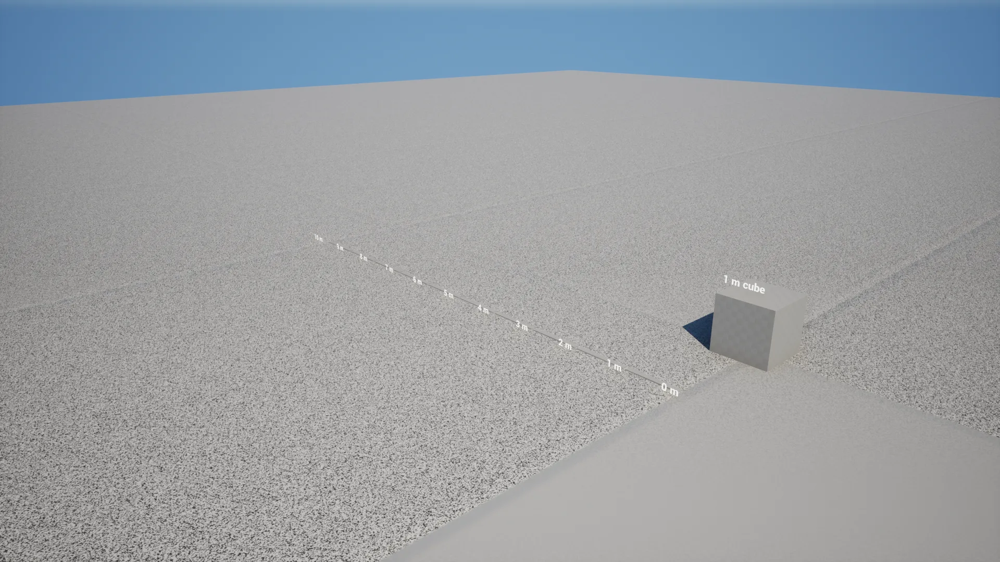
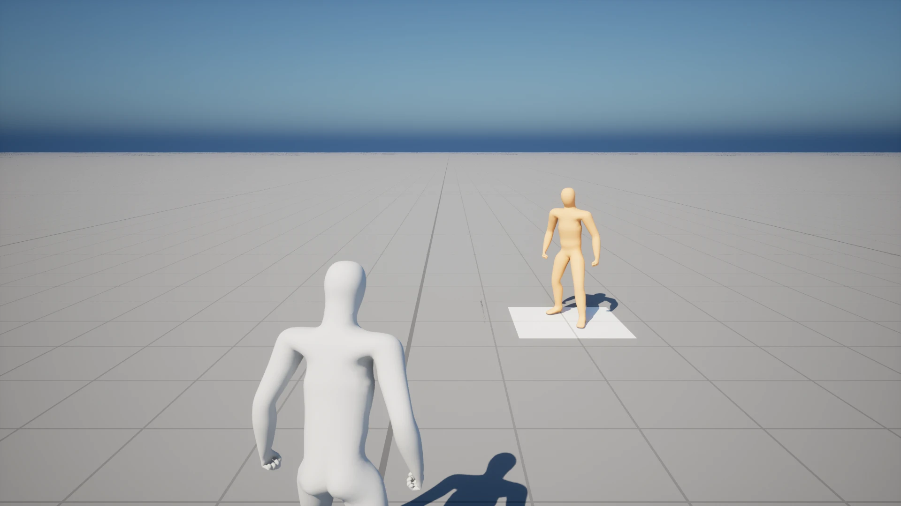

# 2026-11-24-02: Session 5: a dummy, a thrown ball, a launcher and contact hits on the character (#16, #56)

## Narrative

This session built the second half of the goal from decision 0015: something to hit, and a way for things to hit the character. It was not recorded.

Anything that moves into a character now hits it. The body and the movement capsule report what touches them, and the other object's mass and its speed toward the character become a hit of a known size, passed to the same code the push key already used. Below the ragdoll threshold the character staggers, at or above it the character goes down, and it gets up as before. Only the other object's own motion counts, read from the frame before the contact, so walking into a box at rest, standing on one or pushing one is not a hit. Combat moves will deliver their hits through this same entry.

There is now a target dummy on a marked square in both maps: the same character with no controller, tinted orange, running on the player's tuning and tuning changes so a hit feels the same on both. T throws a ball from the chest along the view. The ball passes through the movement capsule and strikes the body part it touches, and never hits whoever threw it. In the gym a launcher throws a ball every two and a half seconds at whoever stands on its square, so the player can be hit too. Backspace puts everything back: the physics boxes where the map placed them, a fresh dummy on its spot, the balls gone and the player at the start. The overlay shows the last hit on the player and on the nearest dummy with the body part, the size and the result, and seven new values (contact speed, scales, limit, repeat time, ball mass and speed) are sliders on the Tuning tab.

Two things were wrong on the way. No hit registered at first, because the engine only reports contacts on a skeletal mesh when a flag on the component is on as well as the flags on its bodies; reading the engine source showed it. And the launcher's ball fell about 80 cm over its 8 metres and passed between the legs, so the launcher now aims up by what the ball drops.

A fresh review found three problems, all fixed. Something the character pushed along its own path, such as a knocked-down dummy, could count as hitting the character back; the hit now uses the smaller of the other object's speed toward the character and the speed at which the two close. Running into the dummy was too harsh at equal mass, so a standing character hitting another is scaled by a new value. And the ball's sphere is only ever created from code, so the packager could have left it out of the Steam build; the engine's basic shapes are now always packaged. Five smaller points are filed as #61.

With the default ball (8 kg at 20 m/s) a hit is a stagger of about 160 cm/s. To knock a character down, raise the ball's mass or speed on the Tuning tab. Checked in the running game: the dummy on its spot, a thrown ball staggering it with the overlay naming the body part, and the reset. Not checked by eye: the launcher hitting the player, and a knockdown from a ball.

Next: upload this as build 0.1.5. After that, the animation block: the character still looks barebones, which this block did not touch.

## Changes

- 70452f2 feat: contact hits, a thrown ball, a launcher and a target dummy (#16, #56)
- 28d2891 feat: the dummy is tinted; docs for contact hits, the ball, the launcher and reset (#16)
- d10b21f fix: contact hits use the closing speed; character contacts are scaled; the ball's mesh is always cooked (#16)

## Decisions touched

_None._

## Captures

## Clip

_No clip._
