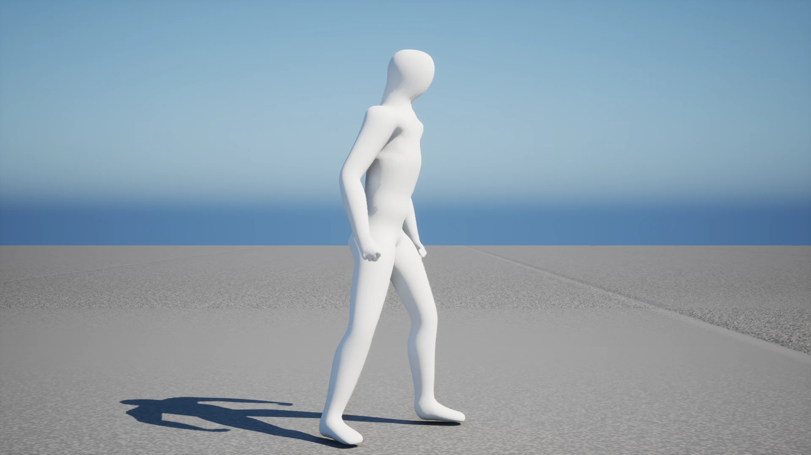
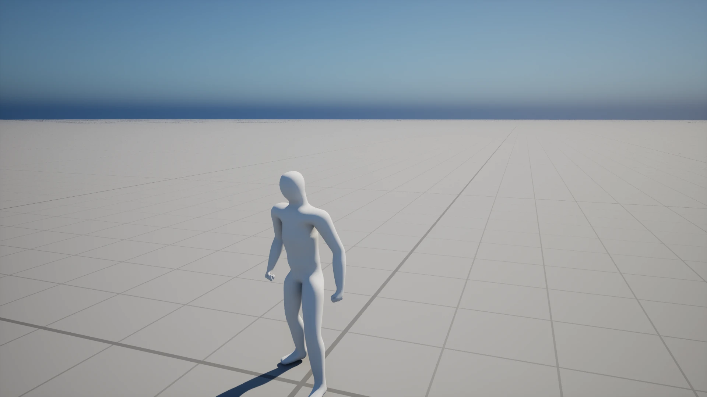

# 2026-11-25-04: An opponent that fights back: a patterned dummy attacker and a block and dodge

## Narrative

<!-- narrative -->

## Changes

- 5f6a692 docs: decision 0019, an opponent that fights back with a block and a dodge (OD-019)
- e72576f feat: an opponent that fights back, with a block and a dodge (decision 0019)
- 39e5771 fix: review findings on the opponent and the guard

## Decisions touched

- ADR-0019
- OD-019

## Captures

## Clip

_No clip._
