# 2026-11-25-04: An opponent that fights back: a patterned dummy attacker and a block and dodge

## Narrative

Decision 0019 (OD-019) chose the next block: an opponent that fights back. A dummy in a run can now be set to fight. An AI controller then runs a short pattern, adapted from the telegraphed opponent in the Game-Systems catalogue: it closes in, throws one punch or a pair, recovers, backs off, circles and comes again. Its punch is the player's own punch with a slower wind-up. That wind-up is the tell, and the run sets its length, so it is also the difficulty. It waits while the player is down, reels when it is staggered, and stops when the run ends.

The player has a block and a dodge. The block is held on the right mouse button or the left trigger. It steers both fists up in front of the face and slows movement, and a hit from the front keeps only a fifth of its force and counts as blocked, not landed. The dodge is on Q or the X button: a quick step the way the player is moving, or straight back, with a cooldown and no immunity. To make the dodge fair, a punch's step-in now goes to where its target stood when the punch began, leashed to 40 cm, so stepping away escapes it. A long wind-up only steps in at its end. The run results count blocked hits, the opponents' punches thrown, landed, blocked and missed, and dodges.

The scripted play-test gained a fight scenario, which found two real problems before any test did. The opponent's punch carried it around the player's side. Then a punch that stopped at body contact fell just short. An independent review found five more, all fixed: punching mid-dodge, dodging off a ledge, a dummy soaking another's punch, a blocked punch driving on through the guard, and a staggered opponent walking on. All 120 tests pass. Build 0.1.10 is on the development branch. The packaged play-test's numbers matched the editor run, but its recording only showed the lock screen, so its visuals were reviewed in the editor build instead.

Next: the opponent still throws some punches from just out of reach, which reads as whiffing; the guard is a code pose that looks stiff; and more attacks or a weapon are now worth deciding on, with a duel to judge them in.

## Changes

- 5f6a692 docs: decision 0019, an opponent that fights back with a block and a dodge (OD-019)
- e72576f feat: an opponent that fights back, with a block and a dodge (decision 0019)
- 39e5771 fix: review findings on the opponent and the guard

## Decisions touched

- ADR-0019
- OD-019

## Captures

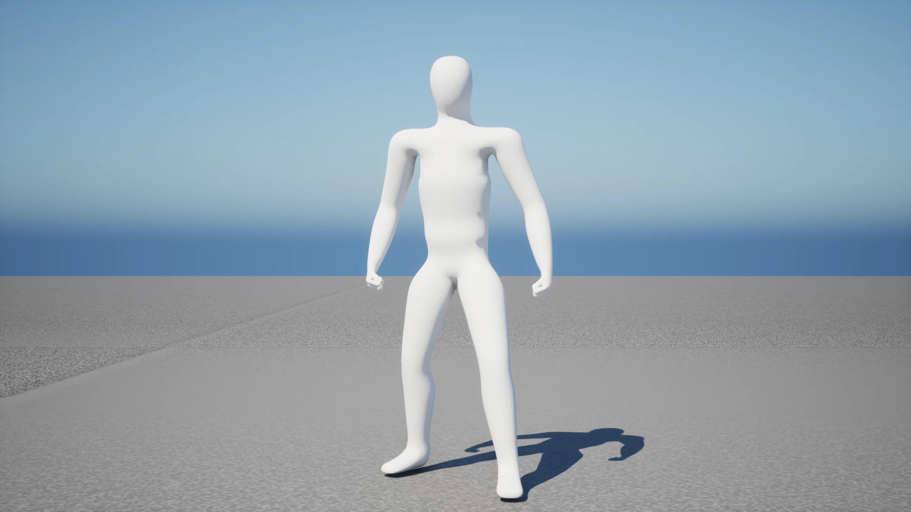

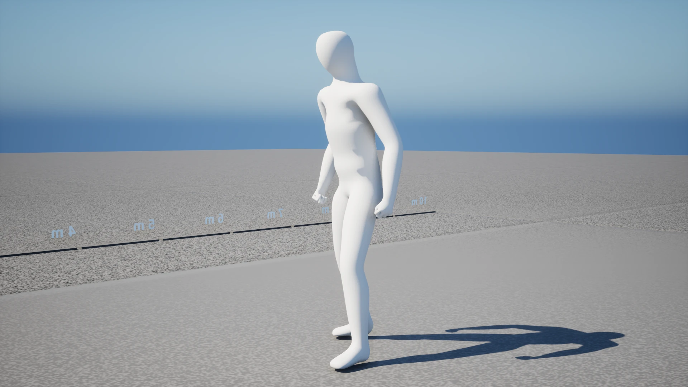
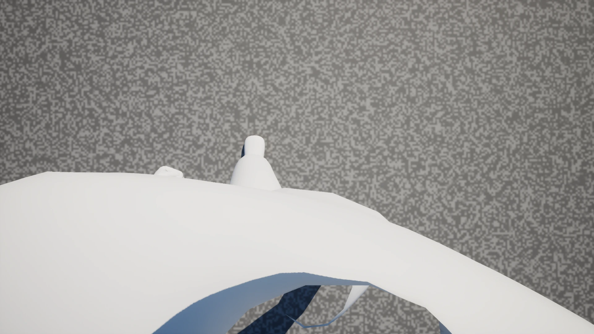
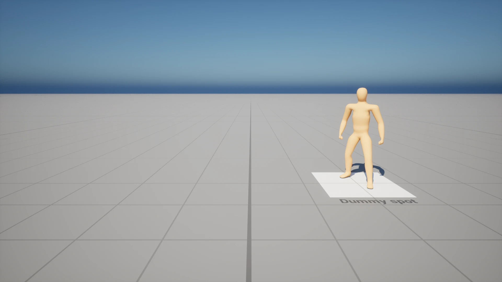
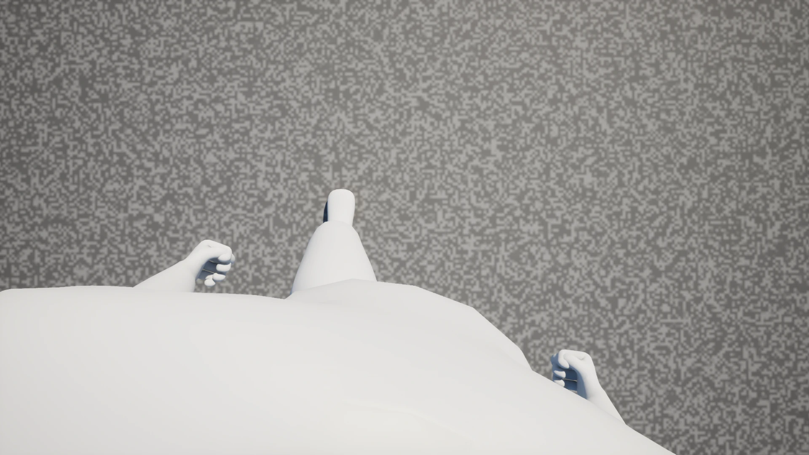
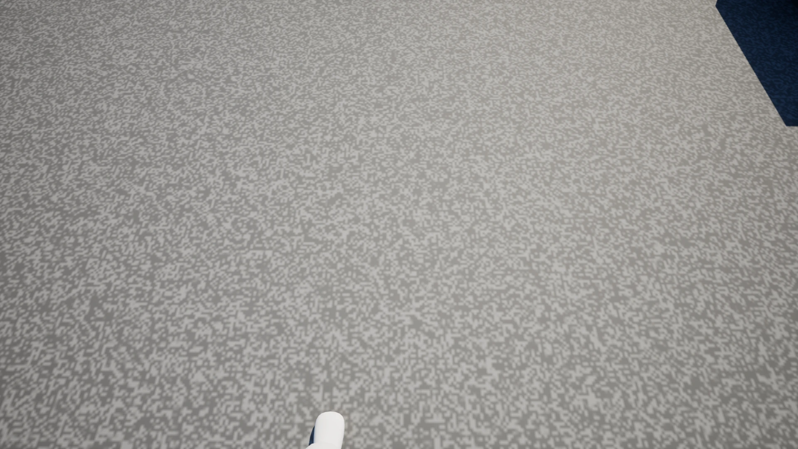
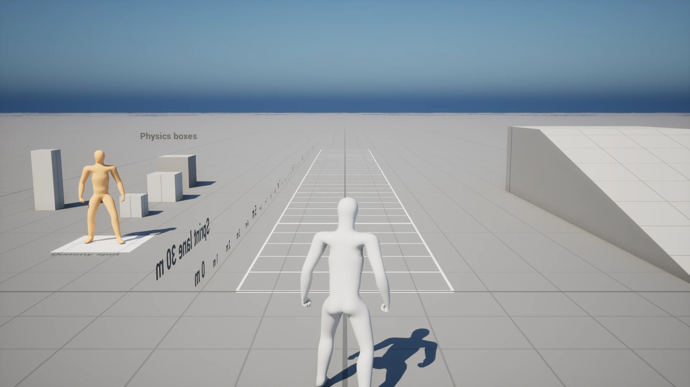
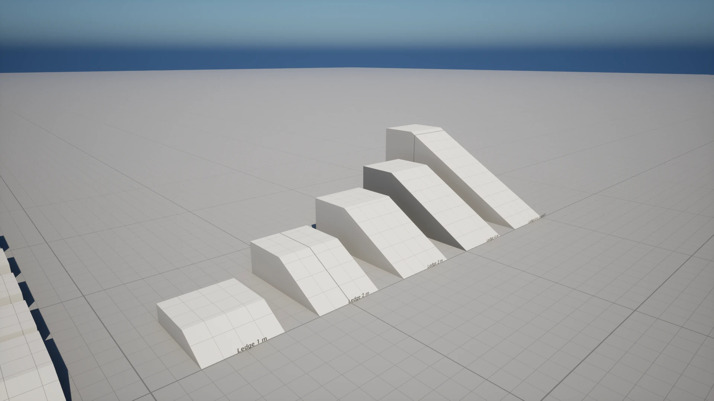
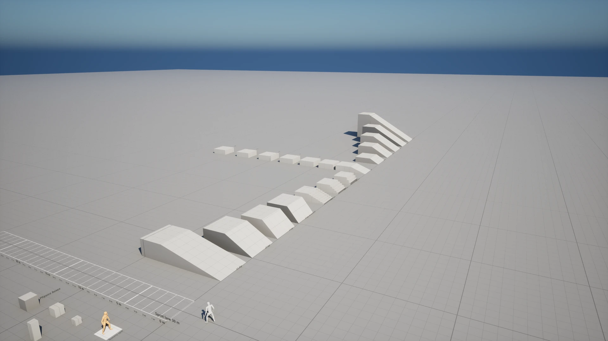
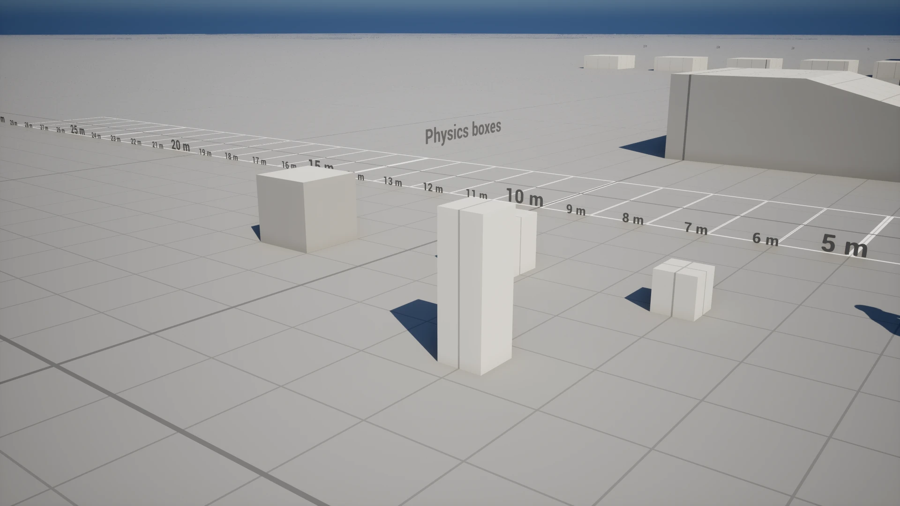
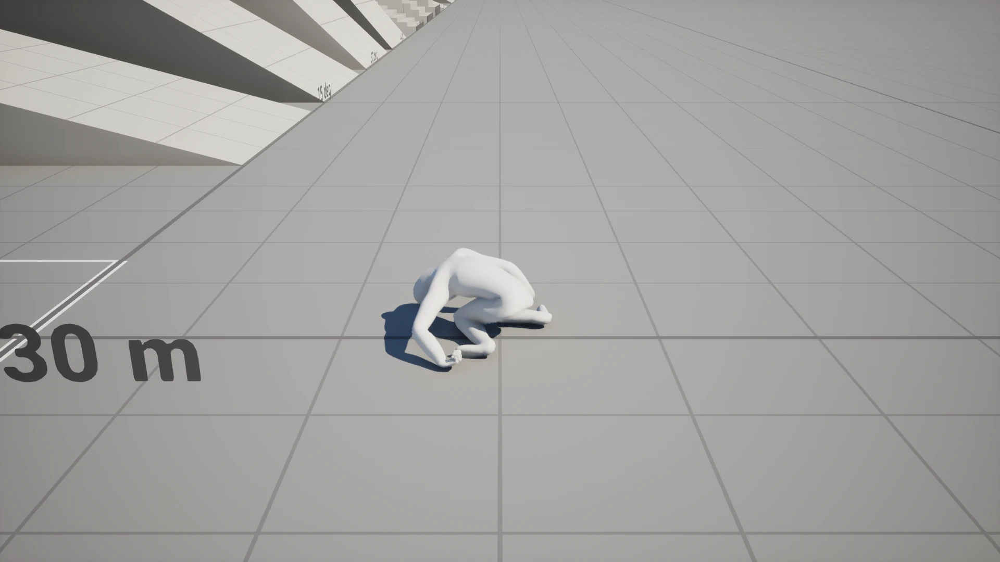
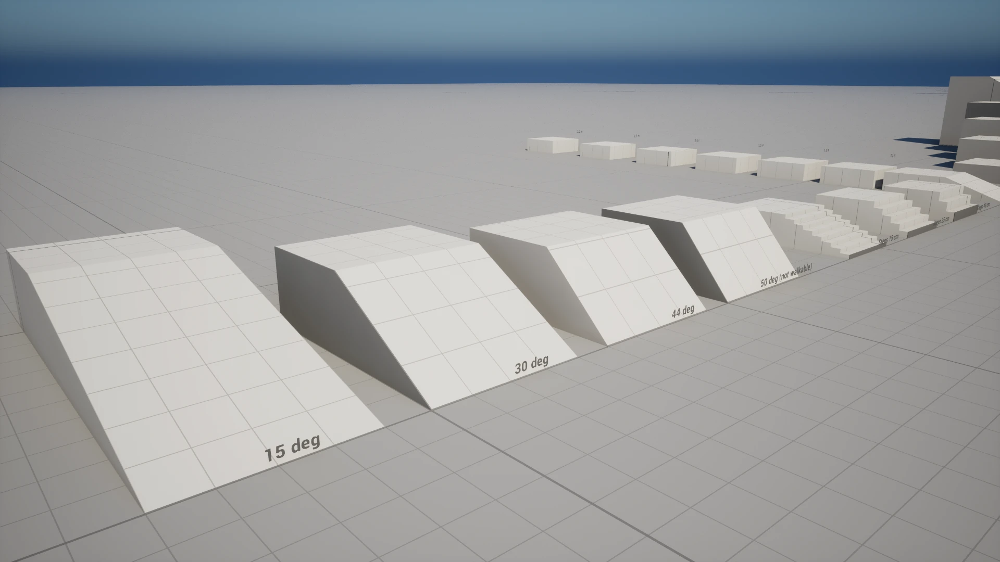
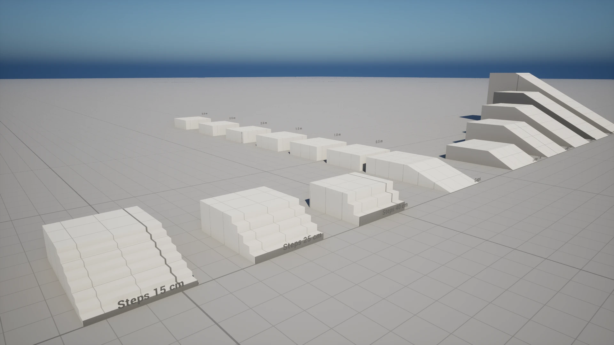
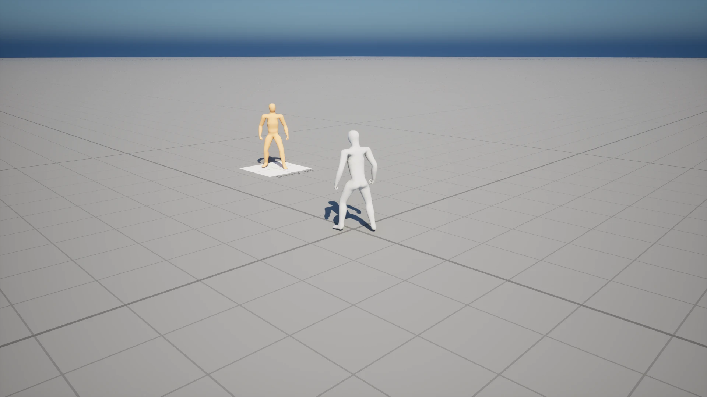
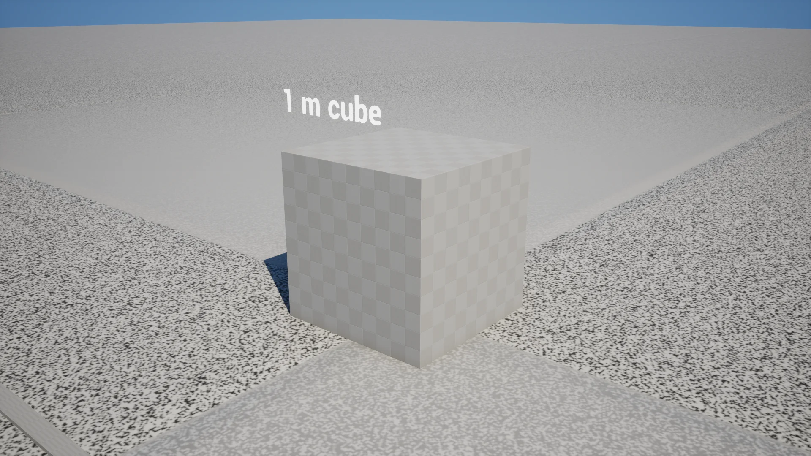
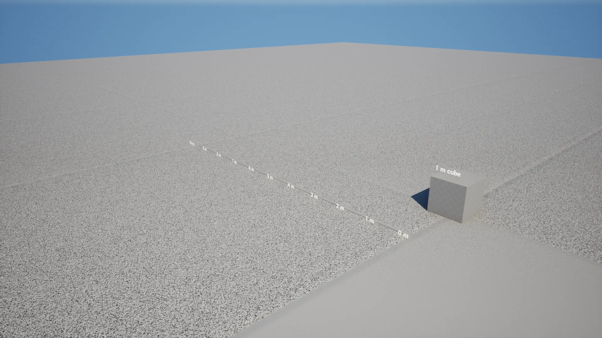

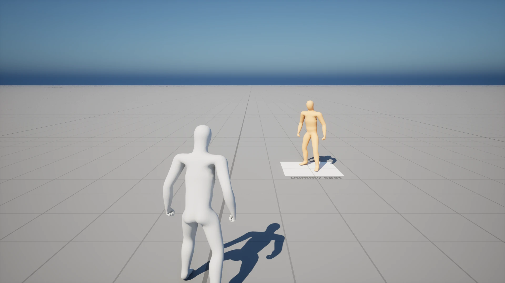

## Clip

_No clip._
