# 2026-11-26-05: README and Pages site upgrade, with CI for both

## Narrative

The README and the public site were reworked, and both are now checked on every push. The site used to open on the devlog list on default browser styles. It now opens on a full-width still of a front kick from a recorded play-test of build 0.1.11. It is dark by default, in the game's own colours: the grey grid floor under the header, the dummy's orange as the accent, the sky's blue for links. The home page says what the game is in plain terms. It shows where things stand (the newest decision, build and session, and the open questions), what is in the build and the controls, recent sessions, how work moves, and the fixed cameras' latest shots. The status is read from docs/ and the build contents from the README, so the page cannot claim what the repository does not. The first draft looked like a stock landing page, and the owner asked for it darker, with a bigger hero and less generic writing; the second draft follows that. Every page gained a description, social preview tags and a favicon, and the build now writes a 404 page, a sitemap and robots.txt.

The README leads with the same kick, then a short plain account of the game and two more stills, and its lists read as sentences instead of bold lead-ins. A new `og docs check` fails when the README's status lags the newest decision or Steam build, or a doc links to a missing file. CI runs it, together with a full site build that fails on a broken link, on every push and pull request. The release script now updates the README's build line in the same commit as the ledger row, so a release cannot leave the README behind. The live site was checked after the deploy: every page served, with no console errors.

## Changes

- 2c140e9 Site: a home page for the game, a dark look, and the basics
- 02f8754 docs: a README that leads with the game
- 11d2f3e ci: check the README and the site on every push and pull request

## Decisions touched

_None._

## Captures

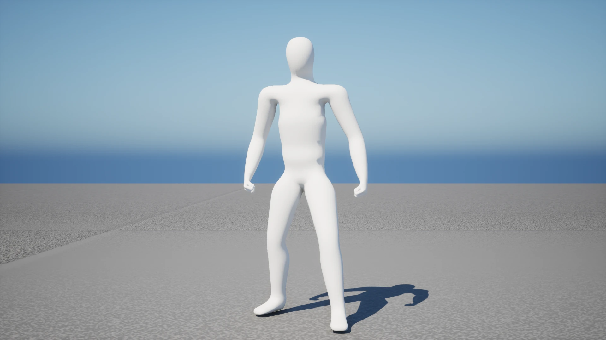

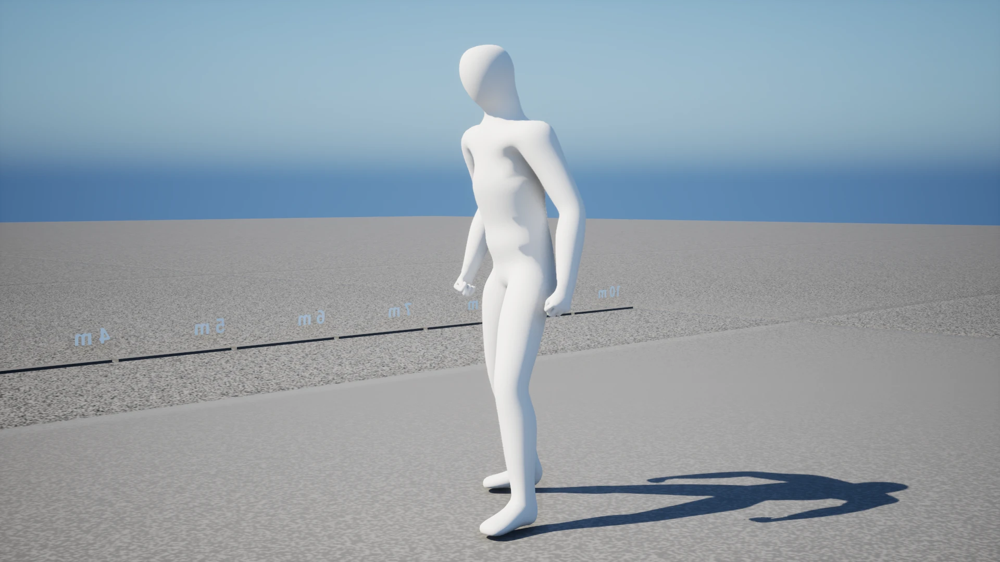
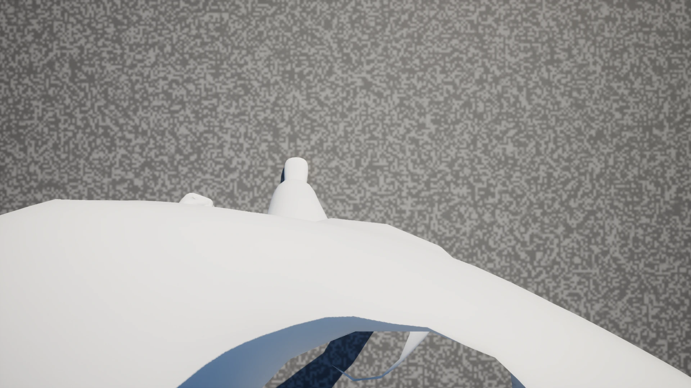
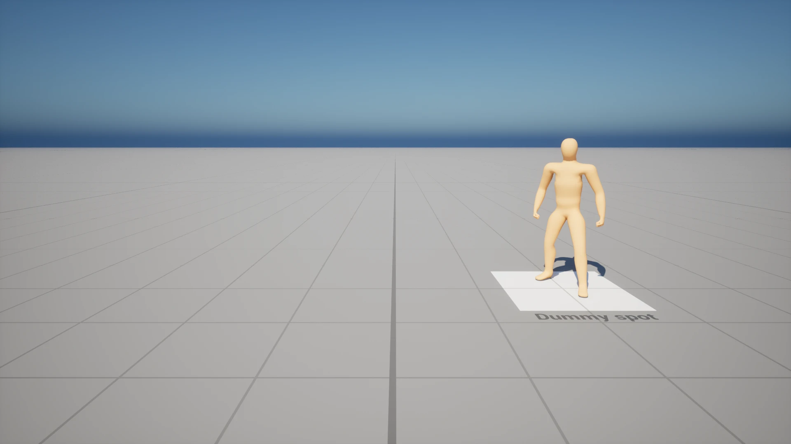
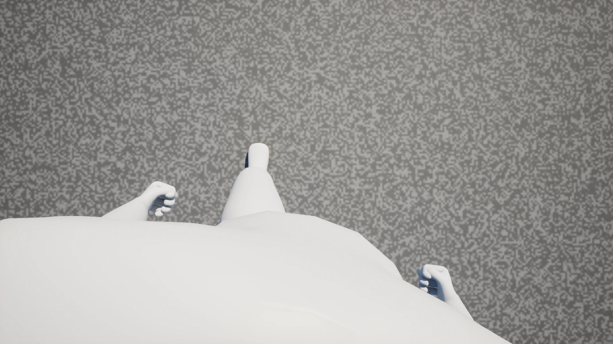
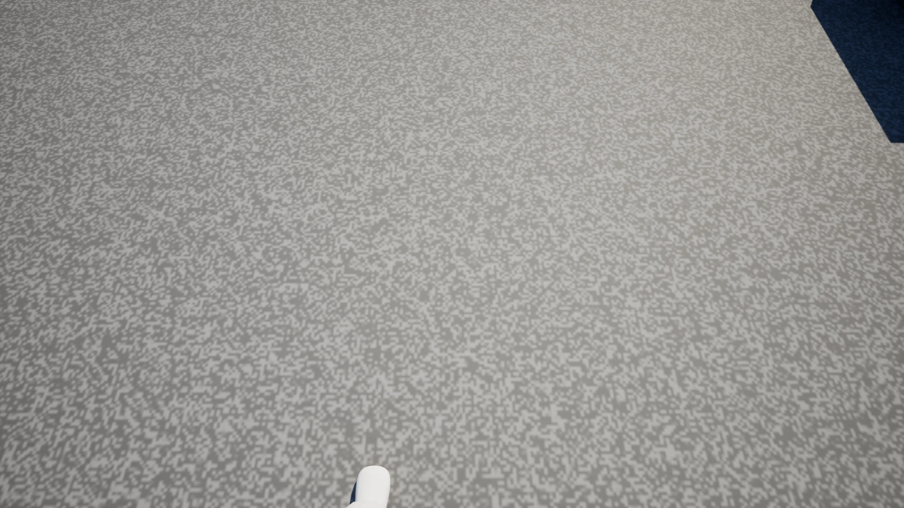

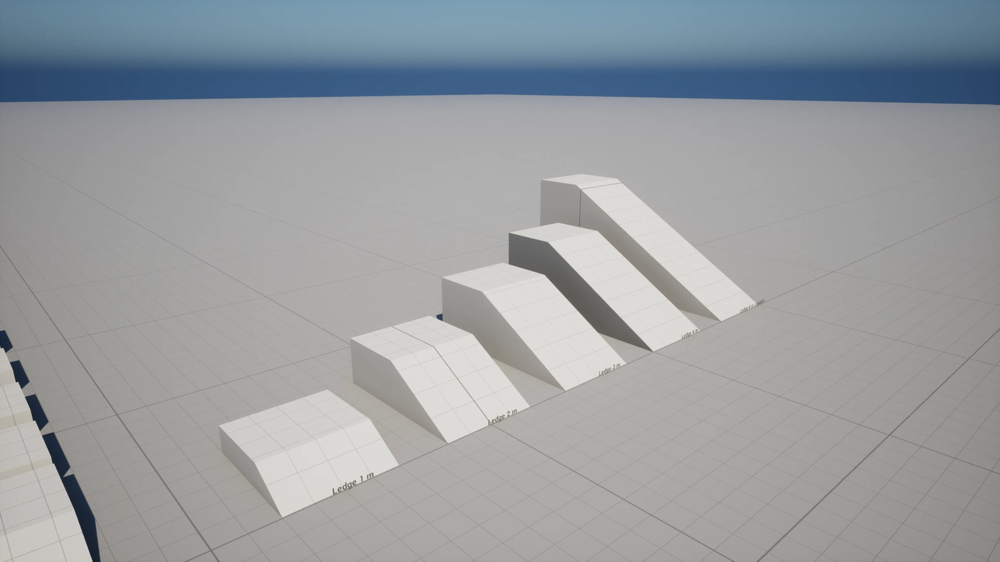
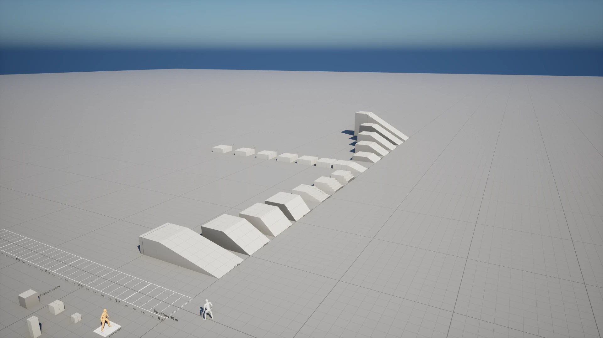
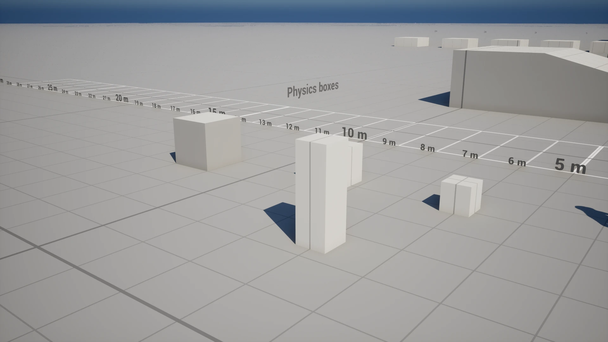
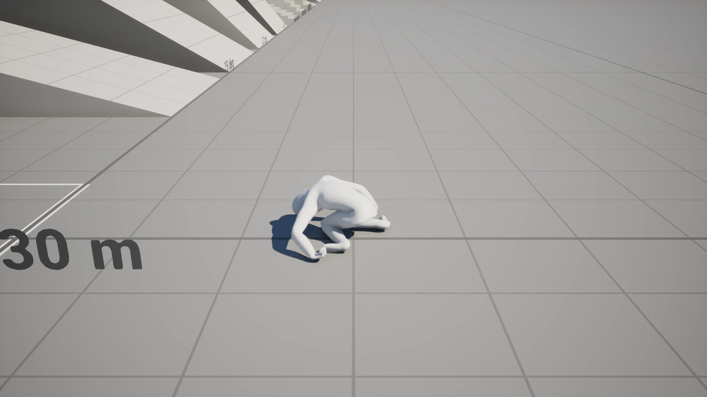
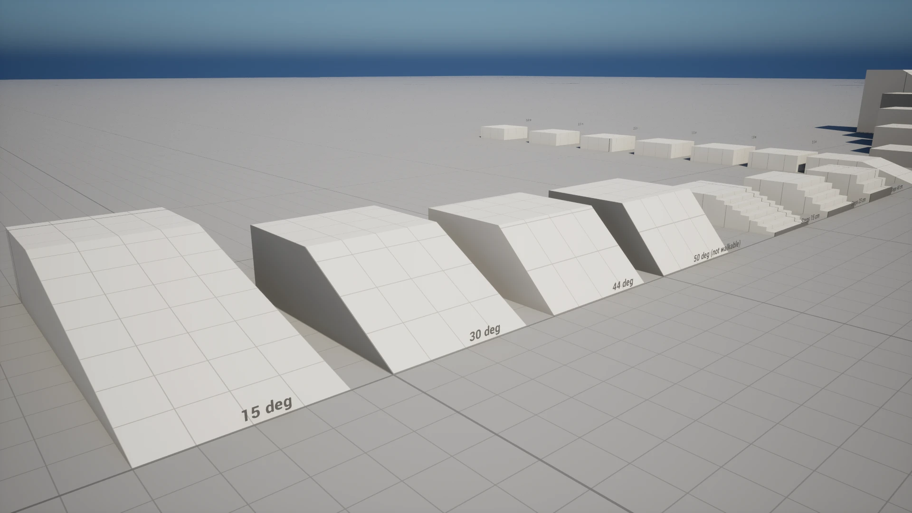
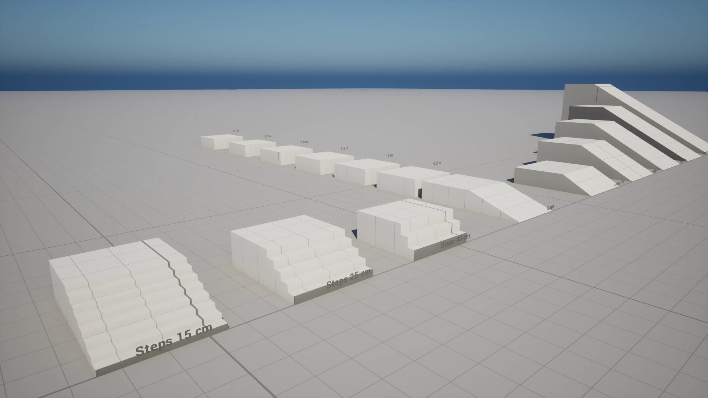

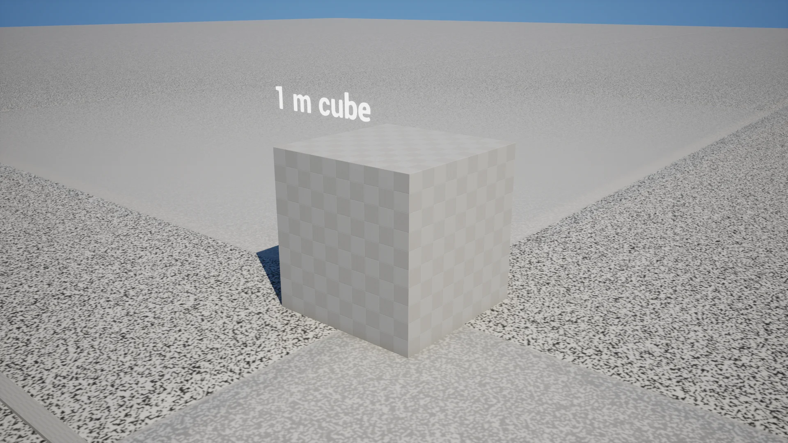
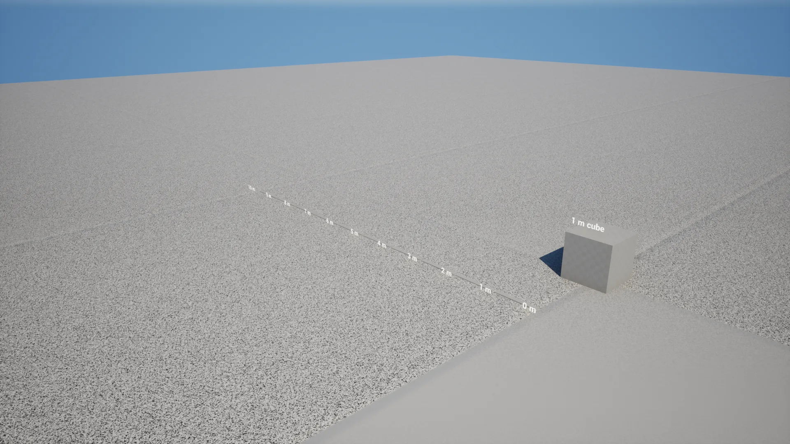

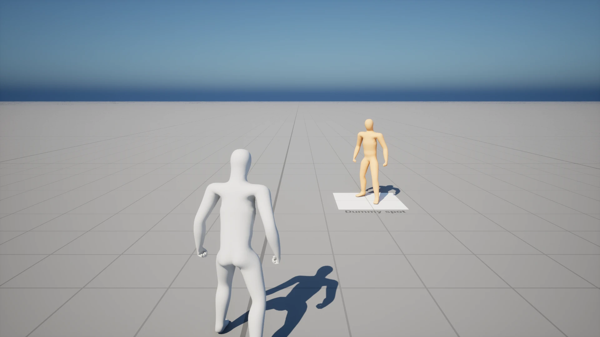

## Clip

_No clip._
