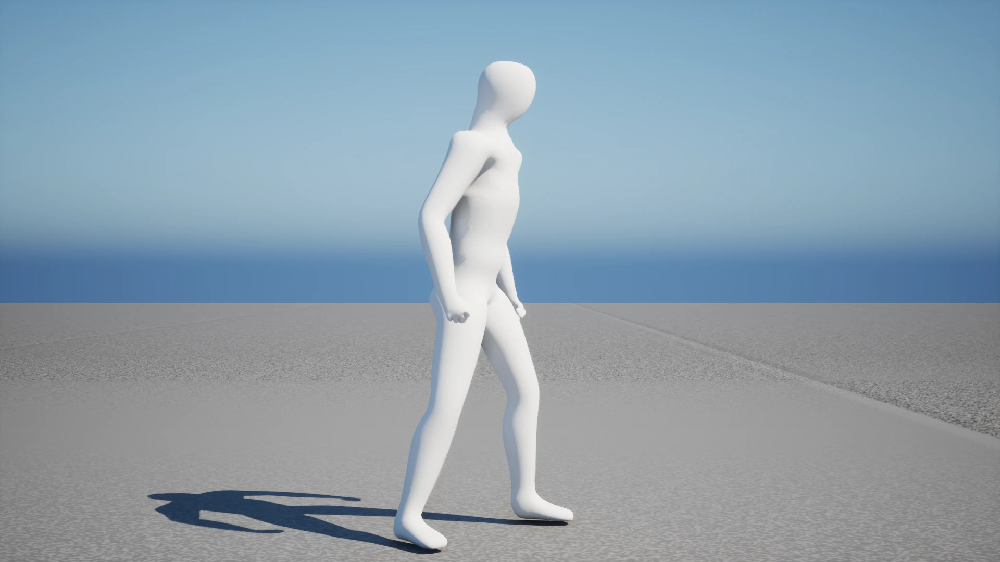
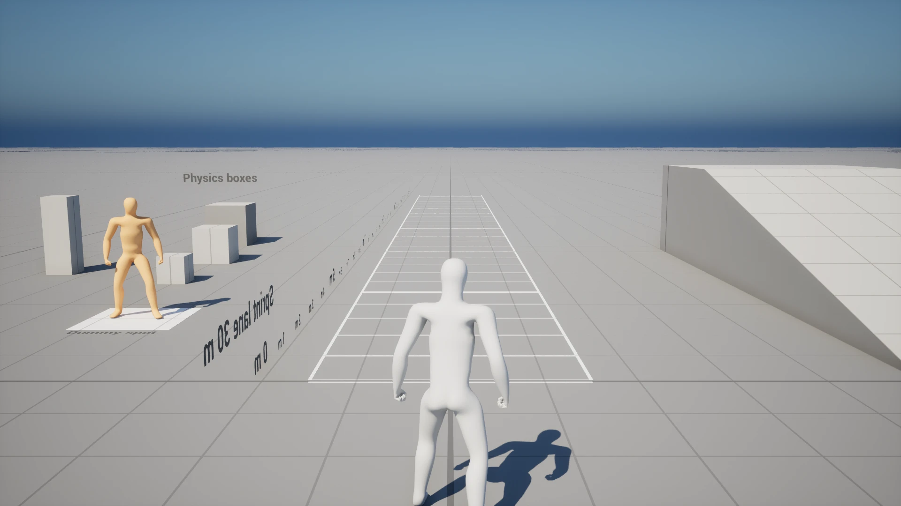
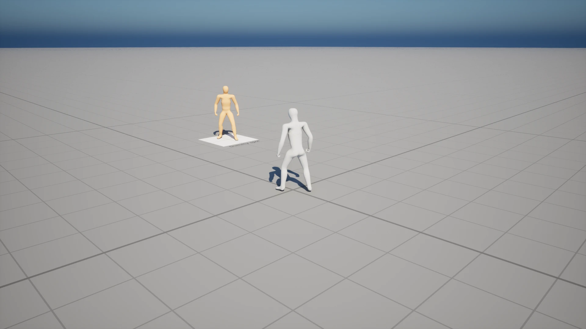
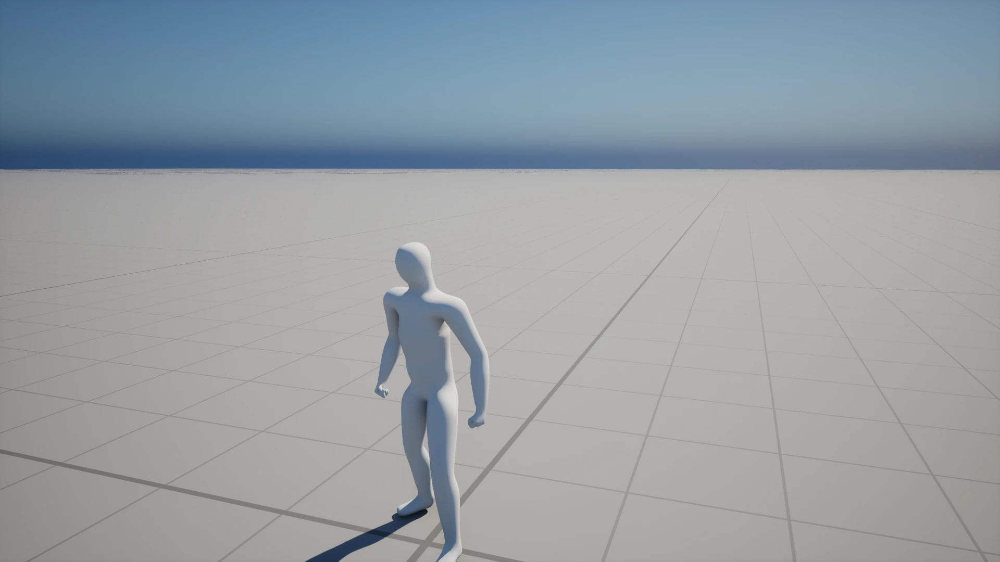

# 2026-11-26-05: README and Pages site upgrade, with CI for both

## Narrative

<!-- narrative -->

## Changes

- 2c140e9 Site: a home page for the game, a dark look, and the basics
- 02f8754 docs: a README that leads with the game
- 11d2f3e ci: check the README and the site on every push and pull request

## Decisions touched

_None._

## Captures

## Clip

_No clip._
